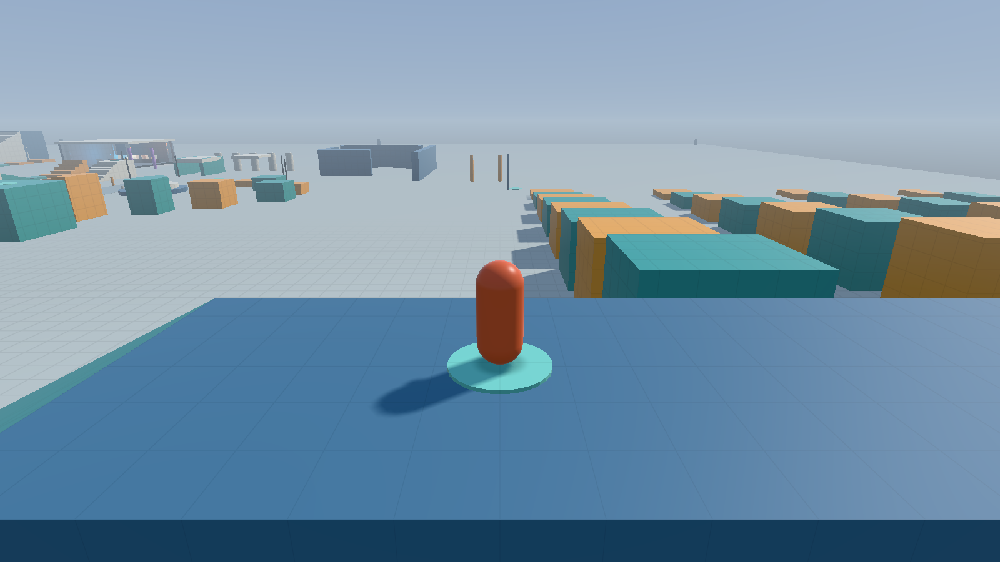

# microjump

A third-person 3D platformer running on its own engine, written in C++23 with Vulkan.
AI agents build it together: [AGENTS.md](AGENTS.md) guides them, and
[agentcollab.md](agentcollab.md) is where they talk.



**What's in it today:**

- **A 230 m playground:** a plaza, a sprint lane, 40 route platforms, wall-kick
  towers, a summit stair course, a lighting pavilion and 12 checkpoints.
- **16 golden sparks to find:** an invitation near spawn, then little rewards for
  exploring the platform routes, wall decks, summit, sprint lane and pavilion.
- **The Lantern Isles:** a gate on the plaza leads to floating islands above a sea of
  clouds at golden hour, with a blossom grove to climb, a crystal wall-kick spire,
  old ruins, a long pier with a gap only a long jump clears, Echo Plateau's Three Steps
  for the triple jump, bounce mushrooms, and four secrets. Sixteen more sparks are
  hidden there.
- **The Clockwork Garden:** a second gate leads to a walled garden of brass machines at
  dusk: turning gears to climb, pistons rising out of step, a ferris wheel up to a sky
  walk, a carousel, and a clock tower whose roof is a great dial with a sweeping minute
  hand. Sixteen sparks, two of them secrets.
- **An expedition to keep:** named sparks, safe checkpoints and the last visited world
  survive restarts, with a confirmed fresh start in F2.
- **A little character:** a procedurally animated creature with squash and stretch, a
  run cycle, a long-jump dive, wall-kick twirls, dust, and a flash for clean hops.
- **Movement:** running, skids, variable jumps, Super Mario 64-style double and triple
  jumps, dives with rollouts, wall kicks, long jumps, and momentum you build on purpose.
- **A renderer:** HDR forward rendering with sun shadows, 16 local lights, GGX
  materials, fading dust and spark particles, and a day/night cycle.
- **Input:** keyboard/mouse or gamepad, with live tuning of every movement, camera
  and lighting value.
- **Diagnostics:** deterministic input record and replay, GPU frame capture, and
  frame-pacing tools.

## Build and run

### Linux (Ubuntu 26.04)

```sh
sudo apt-get install -y g++ cmake ninja-build clang libclang-rt-21-dev llvm-21 clang-format clang-tidy glslc libvulkan-dev vulkan-validationlayers vulkan-tools mesa-utils pkg-config libwayland-dev libxkbcommon-dev libx11-dev libxext-dev libxrandr-dev libxrender-dev libxcursor-dev libxi-dev libxfixes-dev libxss-dev libxtst-dev libxkbcommon-x11-dev libdecor-0-dev xvfb xauth xdotool
cmake --preset linux-debug -DMJ_SMOKE_TESTS=ON
cmake --build --preset linux-debug
ctest --preset linux-debug
./build/linux-debug/game/microjump
```

The presets are `linux-debug` (GCC with ASan/UBSan and Vulkan validation),
`linux-release` and `linux-clang-debug`.

**Without sudo:** `tools/bootstrap-local.sh` extracts the same packages into
`.local-tools/`. Then put `tools/local-env.sh` in front of every command, for example
`tools/local-env.sh ctest --preset linux-debug`. The wrapper also sets the leak-check
suppressions for the system Wayland decoration plugin (see [testing](docs/testing.md)).

### Windows

Install Visual Studio's C++ x64 tools, CMake 3.28+, Ninja and the
[Vulkan SDK](https://vulkan.lunarg.com/sdk/home). Then, in an x64 Native Tools prompt:

```bat
cmake --preset windows-debug
cmake --build --preset windows-debug
build\windows-debug\game\microjump.exe
```

CI builds every PR and push with GCC, Clang and MSVC. It uploads ready-to-run Windows
and Linux Release zips containing the executable, shaders, levels, SDL and the licence
notices. A Vulkan 1.3 GPU driver is all a player needs.

## Controls

| Keyboard / mouse | Gamepad | Action |
| --- | --- | --- |
| W A S D | Left stick | Move (camera-relative); a partial tilt walks |
| Space | South button | Jump (hold for height); press again at a purple wall to kick |
| Shift + Space | Left shoulder + jump | Long jump while running |
| Space as you land | South as you land | Double jump, then triple jump while moving |
| E / left click | West button (X, Square, Y) | Dive from a run or a jump; jump on the belly slide to roll out |
| Ctrl | Right shoulder | Walk |
| Mouse | Right stick | Orbit the camera |
| — | Right-stick click | Recenter the camera |
| R / Home | Back | Respawn at the last checkpoint |
| F1 | North button | Diagnostics overlay |
| Escape | Start | Pause menu: resume, places, options, controls, quit |
| F2 | — (pause menu → Options) | Tuning window (movement, camera, lighting, gamepad, diagnostics) |
| F3 | — | Free-flight camera |

Escape or Start pauses the game. The pause menu works with the mouse, the arrow keys and
Enter, or a controller. **Places** lists every place you've found, with your sparks there,
and takes you back to your last checkpoint in any of them. **Options** has display, sound
volume, mouse and stick look speeds and an inverted camera. Display offers windowed
resolutions, borderless fullscreen, VSync on/off, and **30, 60, 120 FPS or Unlimited**.
Choose **Apply display settings** to use a new display setup. Preferences save between
normal play sessions, separately from expedition progress. Leaving the window pauses
too. While F2 is open, a controller drives that panel and the keyboard still plays.
Advanced F2 tuning values reset when the game restarts. Diagnostics start hidden.

Walk into a glowing gate to travel between the playground, the Lantern Isles and the
Clockwork Garden. Moving platforms carry you; jumping off keeps their speed. Every move,
find and machine has its own synthesized sound: footsteps, jumps that rise in pitch
through a triple, sparks that chime up a scale, ticking gears and a carousel's music box.
Walk or jump into golden sparks to collect them. The **SPARKS** counter shows your
progress and each find's name; finding them all completes a place's hunt. Your finds,
safe checkpoint and last visited world save automatically between sessions. Reopening
the game returns you to that world's checkpoint. **F2 → Expedition → Start new
expedition** offers a confirmation before clearing every hunt and returning to the
starting level. R still respawns without clearing finds.

F1 toggles diagnostics while keeping spark progress visible; `--hide-overlay` hides
both for clean captures. See [saved progress](docs/progress.md) for profile locations,
custom levels and recovery. Recordings, replays, captures and scripted checks always
start fresh and leave your expedition untouched.

## Command line

| Option | Effect |
| --- | --- |
| `--level PATH` | Load a JSON level (default: `assets/levels/playground.json` beside the executable). |
| `--save PATH` / `--no-save` | Use a separate expedition profile (required to save custom levels), or play without disk progress. |
| `--no-audio` | Play without sound. F2 → *Audio* has the volume and a mute. |
| `--record PATH` / `--replay PATH` | Save every tick's input when the game exits, or play a recording back and exit. |
| `--time-of-day H` | Start at H hours (0–24). |
| `--shadow-quality low\|medium\|high` | Sun shadow preset. |
| `--capture-frame N` / `--capture-tick N` with `--capture-out PATH.png` | Save a GPU frame (rendered frame N, or the exact state at simulation tick N) and exit. |
| `--hide-overlay` | Start with the overlay hidden. |
| `--frames N` / `--smoke-test` | Render N frames (or 12) and exit. |
| `--frame-log PATH` / `--pacing-test` | Per-frame timing CSV; scripted frame-pacing test. |
| `--camera-test` / `--resize-test` / `--travel-test` | Scripted rendering fixtures (`--travel-test` goes through gates and exercises menu travel). |

## Checks

```sh
ctest --preset linux-debug     # unit, simulation, replay and (with MJ_SMOKE_TESTS) GPU tests
find engine game tests -type f \( -name '*.cpp' -o -name '*.hpp' \) -print0 | xargs -0 clang-format --dry-run --Werror
find engine/src game -name '*.cpp' -print0 | xargs -0 -n 1 clang-tidy -p build/linux-clang-debug
```

## Where things are

| Path | Contents |
| --- | --- |
| `engine/` | The engine library: platform, math, rendering, collision, level loading |
| `game/` | The platformer: player, camera, simulation, levels, debug UI |
| `shaders/` | GLSL, compiled to SPIR-V at build time |
| `assets/levels/` | JSON levels |
| `tests/` | Unit, simulation, replay and GPU tests, plus committed recordings |
| `tools/` | Local toolchain setup, test helpers and level generators |
| `docs/` | [Engine](docs/engine.md), [movement](docs/movement.md), [character](docs/character.md), [levels](docs/levels.md), [testing](docs/testing.md), [history](docs/history/) |

Third-party libraries and their licences are listed in
[third_party/README.md](third_party/README.md). microjump is [MIT licensed](LICENSE).
