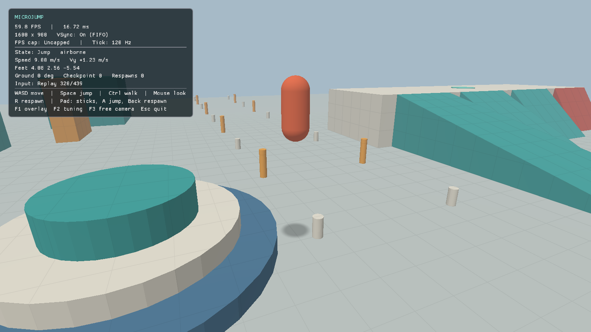

# microjump

A custom C++23/Vulkan 1.3 engine, proven through an original 3D movement playground.
[AGENTS.md](AGENTS.md) is the authoritative charter and roadmap.

M2 adds a playable movement slice. A capsule character runs, skids, jumps with
variable height, coyote time and buffering, and steers in the air. It moves through a
graybox test yard (slopes, stairs, steps, platforms, walls) with an engine-owned
collide-and-slide controller. A third-person camera orbits with obstruction handling.
Input can be recorded and replayed deterministically, and every movement and camera value
is tunable live. Dynamic shadows (M3), the full JSON playground with wall jumps (M4) and
display settings (M5) come later. Details and evidence: [M2 notes](docs/m2-movement.md).



## Linux

Ubuntu 26.04; GCC 15 or Clang 21, CMake 3.28+, Ninja and a Vulkan 1.3 driver:

```sh
sudo apt-get install -y g++ cmake ninja-build clang libclang-rt-21-dev llvm-21 clang-format clang-tidy glslc libvulkan-dev vulkan-validationlayers vulkan-tools mesa-utils pkg-config libwayland-dev libxkbcommon-dev libx11-dev libxext-dev libxrandr-dev libxrender-dev libxcursor-dev libxi-dev libxfixes-dev libxss-dev libxtst-dev libxkbcommon-x11-dev libdecor-0-dev xvfb xauth xdotool
cmake --preset linux-debug -DMJ_SMOKE_TESTS=ON
cmake --build --preset linux-debug --parallel 4
ctest --preset linux-debug
./build/linux-debug/game/microjump
```

Use `linux-release` or `linux-clang-debug` for the other configurations. CMake fetches
only [approved, pinned dependencies](third_party/README.md) and builds shaders with
`glslc`. Debug enables ASan, UBSan and mandatory Vulkan synchronization validation.

Without sudo, `tools/bootstrap-local.sh` extracts Ubuntu development packages into
ignored `.local-tools/`; prefix commands with `tools/local-env.sh`:

```sh
tools/bootstrap-local.sh
tools/local-env.sh cmake --preset linux-debug -DMJ_SMOKE_TESTS=ON
tools/local-env.sh cmake --build --preset linux-debug --parallel 4
tools/local-env.sh ctest --preset linux-debug
tools/local-env.sh ./build/linux-debug/game/microjump
```

The wrapper provides local tool/library paths and a documented Fontconfig-only LSan
suppression for the system Wayland GTK decoration plugin. All other leak checks stay
active. Sanitized builds link SDL's X11 backend directly so Xlib cache roots remain
visible to LSan. See [M0 evidence](docs/m0-evidence.md) and [M1 evidence](docs/m1-evidence.md).

## Controls and capture

| Keyboard / mouse | Gamepad | Action |
| --- | --- | --- |
| W / A / S / D | Left stick | Move (camera-relative) |
| Space | A (south) | Jump; hold for height |
| Ctrl | — | Walk |
| Mouse | Right stick | Orbit the camera (mouse is captured while focused) |
| R / Home | Back | Respawn at the last checkpoint |
| F1 | — | Toggle the diagnostics/movement overlay |
| F2 | Start | Movement and camera tuning window (frees the mouse) |
| F3 | — | Free-flight camera (WASD/QE, Shift fast, Home reset) |
| Escape / close | — | Exit |

The overlay shows FPS/frame time, pixel resolution, effective VSync and cap state, plus
movement state, speed, position, ground angle and checkpoint. VSync is FIFO with no
application FPS cap for now; display-setting controls and persistence are M5. The
simulation runs at a fixed 120 Hz with interpolated rendering, so render rate never
changes movement.

```sh
./build/linux-debug/game/microjump --frames 60
./build/linux-debug/game/microjump --capture-frame 12 --capture-out captures/scene.png
# Record every simulation tick's input on exit, then replay it (exits when it ends).
./build/linux-debug/game/microjump --record captures/run.mjr
./build/linux-debug/game/microjump --replay captures/run.mjr
# Correctness fixtures: camera movement and two live resizes before capture.
./build/linux-debug/game/microjump --camera-test --capture-frame 36 --capture-out captures/camera.png
./build/linux-debug/game/microjump --resize-test --capture-frame 16 --capture-out captures/resized.png
```

Frame numbers are one-based rendered frames. `--capture-frame` saves that frame and
exits; use it with `--capture-out`. PNGs come from the GPU color target after scene
and overlay drawing, before the same image is blitted to the presentation surface.
They use actual pixels, so a high-DPI display can produce a larger PNG than the
logical window size. `--smoke-test` renders 12 frames and exits. Unknown/invalid
arguments fail explicitly. Asset/shader paths resolve relative to the executable.

## Windows

Install Visual Studio's C++ x64 tools, CMake 3.28+, Ninja and the
[Vulkan SDK](https://vulkan.lunarg.com/sdk/home). In an x64 Native Tools prompt:

```bat
cmake --preset windows-debug
cmake --build --preset windows-debug --parallel 4
ctest --preset windows-debug
build\windows-debug\game\microjump.exe --capture-frame 12 --capture-out frame.png
```

CI builds MSVC Debug/Release and uploads a Windows Release zip: executable, compiled
`shaders/`, SDL3, redistributable MSVC runtime DLLs and license notices. Extract the
entire zip and run `microjump.exe`. A Vulkan 1.3 GPU driver is required; Release does
not need an installed SDK. Hosted Windows CI has no suitable GPU, so hardware rendering
and controls on the owner's PC remain a separate acceptance check linked from the PR.

## Verification and packaging

CTest covers math/mesh/CLI correctness, collision queries and the character mover,
movement behavior (jump apex, acceleration, skid, coyote time, buffering, stairs, slopes,
respawn, camera obstruction), bit-identical simulation at different render cadences,
the replay format and a committed real-input replay. With `MJ_SMOKE_TESTS=ON` it adds
GPU render/camera/resize/replay captures and decoded pixel checks. CI uploads those
captures and runtime zips. No benchmarks or FPS targets.

```sh
find engine game tests -type f \( -name '*.cpp' -o -name '*.hpp' \) -print0 | xargs -0 clang-format --dry-run --Werror
find engine/src game -name '*.cpp' -print0 | xargs -0 -n 1 clang-tidy -p build/linux-clang-debug
cpack --config build/linux-release/CPackConfig.cmake -B build/packages
```

For a real SDL input check, install `xdotool` and run `tools/input-smoke.sh` inside
Xvfb. It drives the game with X11 keyboard/mouse events while recording, so the
recording can be replayed and compared; see [docs/m2-movement.md](docs/m2-movement.md).
