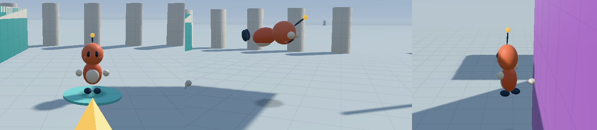

# The character

The player is drawn as a small creature with floating gloves and boots and an antenna with
a spark-gold tip. Collision is still the 0.35 m × 1.6 m capsule from
[movement](movement.md). The character is purely a look and never touches gameplay.

## How it is built

`CharacterAnimator` (`game/character.*`) builds 13 body parts each frame: the body and
belly, the head, eyes, cheeks, the antenna stalk and tip, two gloves and two boots. Every
part is one of two shared unit spheres (`make_part_mesh`: soft plastic or glossy), drawn
with its own scale, rotation and tint. A separate bounded emitter supplies at most 24
camera-facing dust puffs and gold motes to the [particle pass](particles.md).

The renderer accepts any non-mirrored affine transform for a draw. The vertex shader
transforms normals by the cofactor matrix, so squashed spheres shade correctly. For rigid
transforms this is the same rotation as before.

## Rules

- **Fixed tick, visual only.** `main.cpp` ticks the animator right after the simulation,
  like the day/night clock. It only reads `PlayerState`, so every replay keeps its bits.
  It keeps the last two ticks and blends between them like the player does. A tick
  capture therefore shows the same pose at any frame rate.
- **Driven by real motion.** The run cycle advances with the actual ground distance
  covered, so the feet don't slide and stop against walls. The stride grows from
  1.2 m with speed.
- **Teleports snap.** Moving more than 2 m in one tick resets the animator, keeping
  long respawn moves from smearing the body across the level.

## What each move looks like

| Move | Animation |
| --- | --- |
| Idle | Breathing and a blink every 3.7 s. |
| Run | Boots swing and lift, gloves counter-swing, the body bobs and twists. The lean grows with speed, more past a run, and with acceleration. It banks a little into turns, at most about 7°. |
| Fast running | Footfall dust above 10.5 m/s. |
| Jump | A stretch on takeoff, tucked boots, raised arms. |
| Landing | A squash on a bouncy spring, deeper for harder impacts (0.83 after a 2.5 m drop, never below 0.62). The eyes squeeze shut on hard landings, which also kick up a ring of dust. |
| Skid | Leans back with braced boots, arms out, spraying dust ahead. |
| Long jump | A superman dive about the body's middle, with a dust burst at takeoff. |
| Wall kick | A twirl from facing the wall to the new facing plus one full turn, and dust off the wall. |
| Double jump | A puff of dust at takeoff. |
| Triple jump | A forward somersault with knees tucked, and gold sparkles at takeoff. |
| Dive | The long jump's superman pose, with dust when it leaves the ground. |
| Belly slide | Flat on the belly, boots in the air, ploughing dust. |
| Rollout | A quick tucked forward roll back onto the feet. |
| Clean hop | The antenna flashes and gold motes burst at the feet, so kept momentum is visible without F1. |
| Spark found | The antenna flashes, the arms go up, and the body bounces. |

The antenna tip lags behind acceleration on its own spring. Dust expands and fades
through transparent, soft-edged discs; gold motes glow and fade. Both use fixed-tick
births and lifetimes, including interpolation through the final tick of a puff's life.

## Tuning and debugging

The animation constants live in `game/character.cpp`. They are named where they are used
and aren't in F2 yet. **F2 → Collision → Show collision capsule** draws the old capsule
in place of the character, for checking contacts.

`tests/character_tests.cpp` runs the committed move tours through the animator. It checks
that every part stays finite, non-mirrored and near the capsule at three blend factors
per tick, and that the run, dive, twirl, squash, stretch, dust and clean-hop flash all
happen. It also checks that landings squash in order of fall height and settle, that
respawns snap, and that particle births, fades and expiry stay continuous across render
cadences.

## Ideas for later

- A walk cycle for partial stick tilts, and idle fidgets after a while.
- Spark-colored trails at top speed. A sound for clean hops, once there is audio.
- Live F2 sliders for the animation constants.
