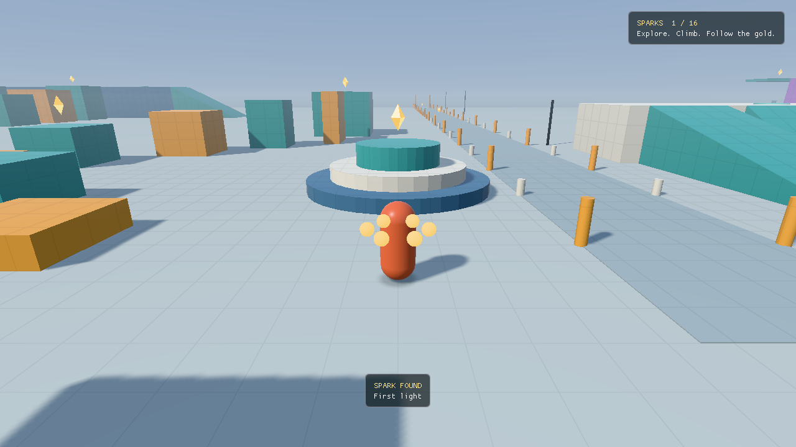

# Levels

Levels are hand-written JSON files in `assets/levels/`. They place primitives generated
by the engine (boxes, ramps, cylinders), lights, checkpoints and named zones. Rendering
and collision are both built from the same placements. Builds copy the levels beside
the executable, and the game loads `playground.json` from there unless you pass
`--level PATH`.

## The playground (`playground.json`)

It is 230 × 230 m on one connected ground surface, made of 229 primitives, with 12
checkpoints (teal pads) and 16 lights. Spawn is at (0, 8) facing north (−Z). The F1
overlay shows the current zone.

Sixteen collectible golden sparks give the routes destinations. The first is five
metres ahead of spawn, with easy climbs on the plaza crown, small stair landing and
yard ramp. The original winding platform route has a midway reward and a finish
reward. Each of the four narrowing western routes has a spark on its final platform;
the finish deck's return ramp also offers a gentler way to explore them. Both wall
decks, the summit, the sprint lane's midpoint and far end, and the pavilion interior
hold the rest. Sparks hover about one metre above a walkable landing, within reach
of the standing player capsule.

The **SPARKS** HUD displays progress, the latest find's name and completion. Collected
sparks stay gone across checkpoint respawns within the current session; restarting
starts a fresh hunt. F1 toggles diagnostics while leaving progress visible, and
`--hide-overlay` hides both for captures. Collectibles do not change collision or
movement, so existing recordings retain their paths.



| Zone | Center (X, Z) | What's there |
| --- | --- | --- |
| Central plaza | 0, 0 | Open ground with a tiered centerpiece, for running, turning and camera work. |
| Sprint lane | 7, −66 | Markers every 5 m out to Z = −110, with a checkpoint at the far end. Good for long-jump chains. |
| Platform field | −69, −33 | Four eight-platform routes of narrowing width (40 platforms in all, counting the original eight) up to a 4.8 m finish deck, with a ramp back down. |
| Wall course | 70, −46 | Two purple wall pairs that climb to 6 m and 8 m finish decks, each with a checkpoint. |
| Slope and step course | 60, 31 | 24 stairs up to a 6 m summit with a ramp back down, plus blocks you can step up and blocks you must jump. |
| Lighting pavilion | 30, 30 | A shaded hall with material samples, orbiting coloured lights and a checkpoint. |
| Yard slopes | 23, −10 | Ramps at 15°, 30°, 45° and 58°. The red 58° ramp is too steep to walk. |

Every raised route has a way round at ground level. The outer edge is open. Falling
below the kill height returns you to the last checkpoint you stood on, and R does too.
Street lamps switch on at dusk.

`movement-yard.json` is the original compact test yard. It is kept because older
recordings and the lighting tests use it.

## Format, version 1

```json
{
  "version": 1,
  "name": "Small yard",
  "kill_height": -25,
  "shapes": [
    {"kind":"box", "center":[0,-0.5,0], "size":[30,1,30], "color":"#c2cac6"},
    {"kind":"ramp", "center":[5,1,-5], "size":[4,2,6], "color":"#42a5a0",
     "yaw":0, "material":{"roughness":0.45,"metallic":0}}
  ],
  "checkpoints": [{"position":[0,0.01,4], "yaw":0}],
  "collectibles": [{"name":"First light", "position":[0,1,0], "radius":0.65}],
  "lights": [{"position":[3,4,1], "color":[1,0.7,0.4], "intensity":30, "range":12,
              "night_only":true}],
  "zones": [{"name":"Plaza", "center":[0,0,0], "radius":12}]
}
```

**Units and conventions:**

- **Units:** meters, with +Y up. Angles are radians.
- **Yaw:** 0 faces −Z, and yaw rotates about +Y. A ramp's high edge is its local −Z
  edge.
- **Colours:** shape colours are sRGB `#RRGGBB`. Light colours are linear RGB, with
  intensity given separately.

| Field | Meaning and defaults |
| --- | --- |
| `version`, `name` | Required. The version is 1. The name is 1–80 UTF-8 bytes with no control characters; recordings store it. |
| `kill_height` | Falling below this Y respawns at the active checkpoint. Default −25. |
| `shapes` | Required, 1–2048 entries. Each needs `kind`, `center`, `size` and `color`. |
| `kind` | `box`, `ramp` or `cylinder`. For a cylinder, size X and Z are the diameter and must match; Y is the height. |
| `center`, `size` | Three numbers. Coordinates must be within ±4096 m; sizes 0.01–512 m. |
| `yaw` | Optional, default 0. |
| `wall_jump` | Optional, default false. Makes the shape's near-vertical faces kickable. Paint these purple so players can read them. |
| `material` | Optional: `roughness` (default 0.7) and `metallic` (default 0), both 0–1. |
| `checkpoints` | Required, 1–64 entries, each with `position` (capsule feet) and an optional `yaw`. The first one is the spawn point. |
| `lights` | Optional, up to 16 entries. Each needs `position` and `color`; the extra fields are below. |
| `zones` | Optional, up to 32 named regions, each with `name`, `center` and an optional `radius` (default 20 m). |
| `collectibles` | Optional, up to 128 golden sparks. Each needs a unique `name` and a `position` (visual centre, within ±4096 m). `radius` is the pickup radius, 0.1–2 m, default 0.65 m; the player's capsule also contributes its own radius. Names use the same 1–80-byte rule as the level name. An omitted or empty array gives no collectible HUD. |

| Light field | Meaning and defaults |
| --- | --- |
| `intensity`, `range` | Intensity at 1 m (10), and the radius where light reaches zero (10 m). |
| `direction` | Spot direction, normalized on load. Default `[0,-1,0]`. |
| `inner_cone`, `outer_cone` | Spot half-angles, 0 ≤ inner ≤ outer ≤ π. The default π for both makes a point light. |
| `orbit_radius`, `orbit_speed` | A horizontal orbit around `position`, in m and rad/s. Default 0. |
| `night_only` | Fades the light in after sunset. |

**Validation.** Malformed JSON, unknown or duplicate fields, wrong types, out-of-range
values and too many elements are all rejected with a message before any window opens.
Files are limited to 2 MiB and 32 levels of nesting. Nothing repairs geometry, so place
each checkpoint just above a safe, walkable surface. Tests settle the player on every
playground checkpoint and spark landing, check pickup clearance and exercise the
invitation, sprint, stair and platform routes.

**Editing tips:** iterate with `--level` on your own copy. Pair `--capture-tick` with
`--hide-overlay` for before/after screenshots. Recordings are tied to the level name, so
renaming a level orphans its recordings.
