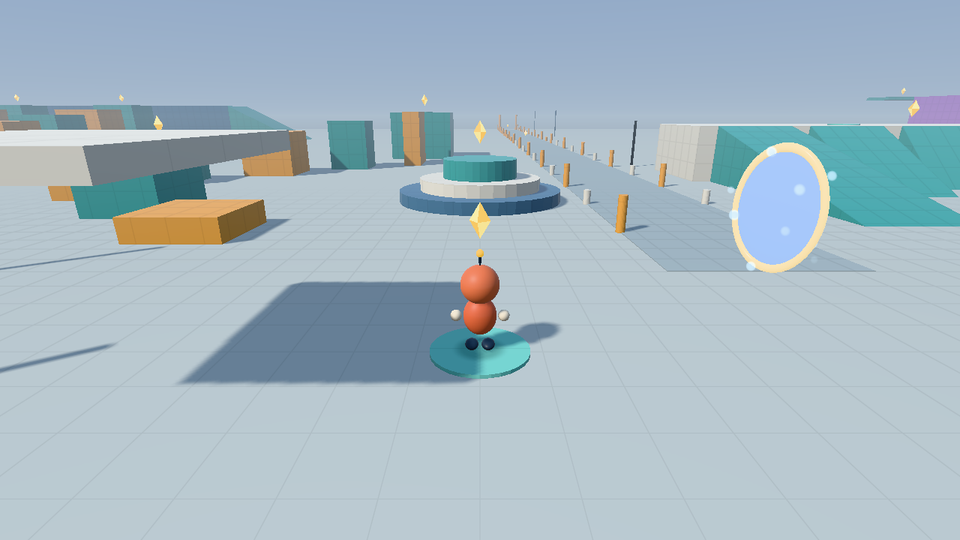
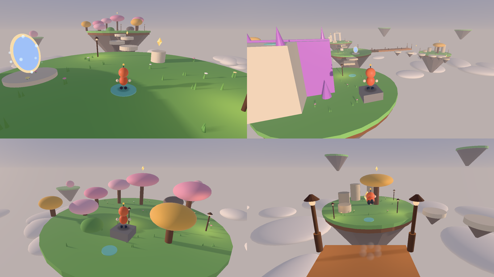

# Levels

Levels are JSON files in `assets/levels/`. They place primitives generated by the engine
(boxes, ramps, cylinders, ellipsoids and cones), lights, checkpoints, named zones, sparks
and gates to other levels. Rendering and collision are both built from the same
placements, except for shapes marked drawn-only. Builds copy the levels beside the
executable, and the game loads `playground.json` from there unless you pass
`--level PATH`.

Two levels ship, joined by gates: walk into the glowing ring near the playground's spawn
to reach the Lantern Isles, and through the isles' home gate to come back.

## The playground (`playground.json`)

It is 230 × 230 m on one connected ground surface, made of 229 primitives, with 12
checkpoints (teal pads) and 16 lights. Spawn is at (0, 8) facing north (−Z). The F1
overlay shows the current zone.

Sixteen collectible golden sparks give the routes destinations. The first is five
metres ahead of spawn, with easy climbs on the plaza crown, small stair landing and
yard ramp. The original winding platform route has a midway reward and a finish
reward. Each of the four narrowing western routes has a spark on its final platform;
the finish deck's return ramp also offers a gentler way to explore them. Both wall
decks, the summit, the sprint lane's midpoint and far end, and the pavilion interior
hold the rest. Sparks hover about one metre above a walkable landing, within reach
of the standing player capsule.

The **SPARKS** HUD displays progress, the latest find's name and completion. Collected
sparks stay gone across checkpoint respawns within the current session; restarting
starts a fresh hunt. F1 toggles diagnostics while leaving progress visible, and
`--hide-overlay` hides both for captures. Collectibles do not change collision or
movement, so existing recordings retain their paths.


| Zone | Center (X, Z) | What's there |
| --- | --- | --- |
| Central plaza | 0, 0 | Open ground with a tiered centerpiece, for running, turning and camera work. |
| Sprint lane | 7, −66 | Markers every 5 m out to Z = −110, with a checkpoint at the far end. Good for long-jump chains. |
| Platform field | −69, −33 | Four eight-platform routes of narrowing width (40 platforms in all, counting the original eight) up to a 4.8 m finish deck, with a ramp back down. |
| Wall course | 70, −46 | Two purple wall pairs that climb to 6 m and 8 m finish decks, each with a checkpoint. |
| Slope and step course | 60, 31 | 24 stairs up to a 6 m summit with a ramp back down, plus blocks you can step up and blocks you must jump. |
| Lighting pavilion | 30, 30 | A shaded hall with material samples, orbiting coloured lights and a checkpoint. |
| Yard slopes | 23, −10 | Ramps at 15°, 30°, 45° and 58°. The red 58° ramp is too steep to walk. |

Every raised route has a way round at ground level. The outer edge is open. Falling
below the kill height returns you to the last checkpoint you stood on, and R does too.
Street lamps switch on at dusk.

A gate, **To the Lantern Isles**, stands on the plaza to the right of spawn.



## The Lantern Isles (`lantern-isles.json`)

A small archipelago of grassy floating islands over a sea of clouds, at five in the
evening. There are 6 checkpoints, 10 sparks and 13 lanterns. Falling below −18 m returns
you to your last checkpoint. The day starts at 17:00 (`--time-of-day` still overrides it),
the graybox grid is off, and the haze carries on below the horizon.



| Island | Center (X, Z) | What's there |
| --- | --- | --- |
| Gate Isle | 0, 0 | Spawn, the gate home, a first spark on a plinth. |
| Stepping Stones | 0, −22 | Four floating stones rising to the grove: a running hop apart. |
| Blossom Grove | −2, −45 | Tree canopies are platforms: a bush, then four canopies 1.4 m apart up to the **Blossom crown**. |
| Crystal Spire | −40, −10 | Slabs west, then the playground's 8 m wall-kick pair. The last kick carries you over the west wall onto the lookout tower. |
| Old Ruins | 39, −2 | Slabs east, broken columns 3 m apart and 1.2 m higher each, and an arch to stand on. |
| The Long Pier | 0, 22 | A runway south. Its end is a 10 m gap and 4 m drop that only a long jump clears; a spark hangs mid-leap. |
| Lantern Isle | 0, 54.5 | Rock steps up a golden lantern tree. |
| Cloud Steps | −13, 36 | Stones back up to the pier, with a nook off to the side. |

The level is laid out by `tools/levels/lantern_isles.py`, which writes the JSON; run
`python3 tools/levels/lantern_isles.py` after editing it. Small touches can go straight
into the JSON, but the script moves whole islands at once and keeps related pieces
together, so prefer it and keep the two in step.

## Designing jumps

Measured from a full run (9 m/s) on the default tuning, with the feet leaving an edge.
Distances are horizontal, from takeoff to where the feet fall back through each height.

| Height of the landing | −4 m | −2 m | 0 m | +1 m | +1.5 m | +2 m |
| --- | --- | --- | --- | --- | --- | --- |
| Running jump (apex 2.6 m) | 8.6 m | 7.9 m | 6.8 m | 6.2 m | 5.7 m | 5.2 m |
| Long jump (apex 1.2 m) | 12.2 m | 10.5 m | 8.2 m | 5.9 m | — | — |

- A chain of hops at full speed flies about 6.5 m. Space small platforms about that far
  apart, center to center, so players can keep their speed. Closer, smaller landings
  ask them to slow down and hop carefully, which suits a climb, not a run.
- A gap that needs a long jump should beat the running jump by a clear margin: the pier
  asks for 10 m with a 4 m drop, where a running jump reaches 8.6 m.
- Two slopes too steep to stand on hold you where they meet, so a V between canopies or
  rocks is a place to stand, not a trap.
- `tests/lantern_isles_tests.cpp` plays each route with a small driver that hops like a
  player. Reuse it to check a new route before you call it done.

`movement-yard.json` is the original compact test yard. It is kept because older
recordings and the lighting tests use it.

## Format, version 1

```json
{
  "version": 1,
  "name": "Small yard",
  "title": "The Small Yard",
  "kill_height": -25,
  "atmosphere": {"time_of_day": 17, "fog": 0.75, "grid": false, "sky_below": true},
  "shapes": [
    {"kind":"box", "center":[0,-0.5,0], "size":[30,1,30], "color":"#c2cac6"},
    {"kind":"ramp", "center":[5,1,-5], "size":[4,2,6], "color":"#42a5a0",
     "yaw":0, "material":{"roughness":0.45,"metallic":0}},
    {"kind":"cone", "center":[0,-4,0], "size":[12,6,12], "color":"#7a6f6c",
     "tip":"down", "taper":0.12},
    {"kind":"ellipsoid", "center":[0,-20,30], "size":[30,6,20], "color":"#f4efe9",
     "solid":false}
  ],
  "checkpoints": [{"position":[0,0.01,4], "yaw":0}],
  "collectibles": [{"name":"First light", "position":[0,1,0], "radius":0.65}],
  "lights": [{"position":[3,4,1], "color":[1,0.7,0.4], "intensity":30, "range":12,
              "night_only":true}],
  "zones": [{"name":"Plaza", "center":[0,0,0], "radius":12}],
  "portals": [{"name":"To the Lantern Isles", "position":[4,1.6,0], "radius":1.1,
               "yaw":1.57, "level":"lantern-isles.json", "checkpoint":0}]
}
```

**Units and conventions:**

- **Units:** meters, with +Y up. Angles are radians.
- **Yaw:** 0 faces −Z, and yaw rotates about +Y. A ramp's high edge is its local −Z
  edge.
- **Colours:** shape colours are sRGB `#RRGGBB`. Light colours are linear RGB, with
  intensity given separately.

| Field | Meaning and defaults |
| --- | --- |
| `version`, `name` | Required. The version is 1. The name is 1–80 UTF-8 bytes with no control characters; recordings store it. |
| `title` | Optional display name shown when you arrive through a gate, with the same rules as the name. Default: the name. |
| `atmosphere` | Optional. `time_of_day` (hours, 0–24, default 14.5) starts the day; `fog` (0–8, default 1) scales the fog; `grid` (default true) draws the graybox grid; `sky_below` (default false) carries the sky's haze and light below the horizon, for floating worlds. |
| `kill_height` | Falling below this Y respawns at the active checkpoint. Default −25. |
| `shapes` | Required, 1–2048 entries, at least one of them solid. Each needs `kind`, `center`, `size` and `color`. |
| `kind` | `box`, `ramp`, `cylinder`, `ellipsoid` or `cone`. For a cylinder, size X and Z are the diameter and must match; Y is the height. An ellipsoid fills its box, smoothly shaded. A cone is faceted: size X and Z are its wide end's diameters. |
| `taper`, `tip` | Cones only. `taper` (0–1, default 0) is the narrow end's diameter as a fraction of the wide end; 0 makes a point. `tip` is `"up"` (default) or `"down"`, which end is narrow. |
| `solid` | Optional, default true. `false` draws the shape but leaves it out of collision: clouds, grass, distant scenery. Wall-jump shapes must be solid. |
| `center`, `size` | Three numbers. Coordinates must be within ±4096 m; sizes 0.01–512 m. |
| `yaw` | Optional, default 0. |
| `wall_jump` | Optional, default false. Makes the shape's near-vertical faces kickable. Paint these purple so players can read them. |
| `material` | Optional: `roughness` (default 0.7) and `metallic` (default 0), both 0–1. |
| `checkpoints` | Required, 1–64 entries, each with `position` (capsule feet) and an optional `yaw`. The first one is the spawn point. |
| `lights` | Optional, up to 16 entries. Each needs `position` and `color`; the extra fields are below. |
| `zones` | Optional, up to 32 named regions, each with `name`, `center` and an optional `radius` (default 20 m). |
| `portals` | Optional, up to 16 gates. Each needs a `name` and a `position` (the opening's center) and `level`, a file name beside this level (letters, digits, `-`, `_`, `.`, ending `.json`). `checkpoint` (0–63, default 0) is where you arrive, `radius` (0.3–4 m, default 1.2) the trigger's reach, and `yaw` the way the opening faces. |
| `collectibles` | Optional, up to 128 golden sparks. Each needs a unique `name` and a `position` (visual centre, within ±4096 m). `radius` is the pickup radius, 0.1–2 m, default 0.65 m; the player's capsule also contributes its own radius. Names use the same 1–80-byte rule as the level name. An omitted or empty array gives no collectible HUD. |

| Light field | Meaning and defaults |
| --- | --- |
| `intensity`, `range` | Intensity at 1 m (10), and the radius where light reaches zero (10 m). |
| `direction` | Spot direction, normalized on load. Default `[0,-1,0]`. |
| `inner_cone`, `outer_cone` | Spot half-angles, 0 ≤ inner ≤ outer ≤ π. The default π for both makes a point light. |
| `orbit_radius`, `orbit_speed` | A horizontal orbit around `position`, in m and rad/s. Default 0. |
| `night_only` | Fades the light in after sunset. |

**Validation.** Malformed JSON, unknown or duplicate fields, wrong types, out-of-range
values and too many elements are all rejected with a message before any window opens.
Files are limited to 2 MiB and 32 levels of nesting. Nothing repairs geometry, so place
each checkpoint just above a safe, walkable surface. Tests settle the player on every
playground checkpoint and spark landing, check pickup clearance and exercise the
invitation, sprint, stair and platform routes.

**Gates.** Stepping into a gate in live play loads its level beside the current file and
puts you on its arrival checkpoint, which becomes your respawn point. A bright breath
of light covers the swap, and a card names the place and the zone you arrived in.
Standing near a gate shows its name. Sparks found on each level are remembered until the
game closes, so a round trip keeps both hunts. The target checkpoint is only checked
when you travel. A level that fails to load, or lacks that checkpoint, logs why and
keeps you where you are, so tests load every shipped gate's target. Gates rest while
recording or replaying, because a recording belongs to one level. The simulation only
reports the step into a gate, and the game decides to travel.

**No z-fighting.** Two differently coloured faces in the same plane flicker where they
overlap, and that looks broken. Don't let shapes share a visible plane:
- Stop a pillar under the slab it holds rather than inside it.
- Raise a deck a few centimetres above the grass it crosses.
- Leave out pieces that would sit entirely inside another.

Faces buried inside another solid, and identical surfaces, are fine.
`tests/surface_tests.cpp` checks every shipped level and names the shapes that fight.

**Editing tips:** iterate with `--level` on your own copy. Pair `--capture-tick` with
`--hide-overlay` for before/after screenshots. Recordings are tied to the level name, so
renaming a level orphans its recordings.
