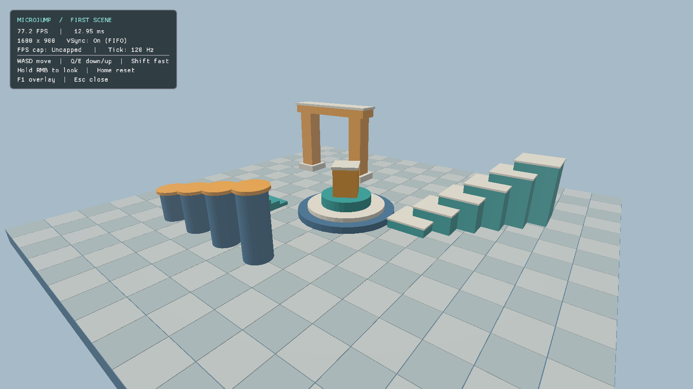
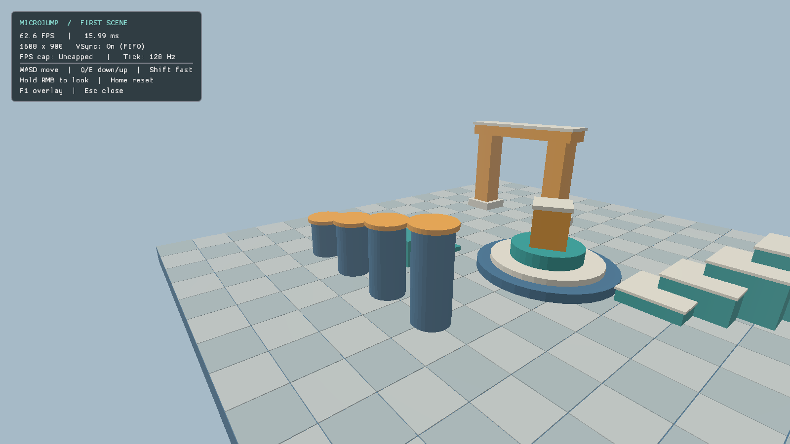
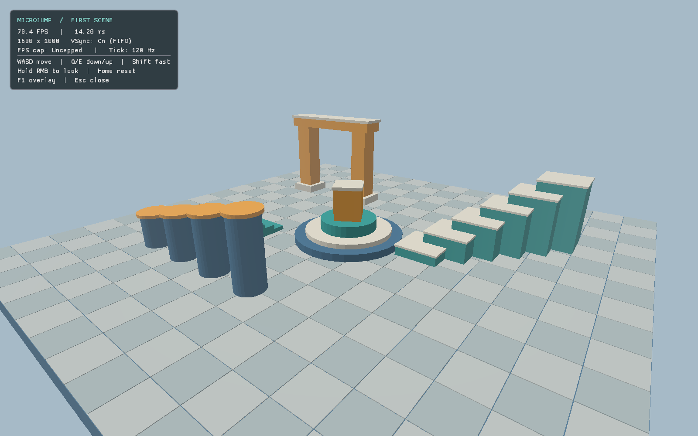
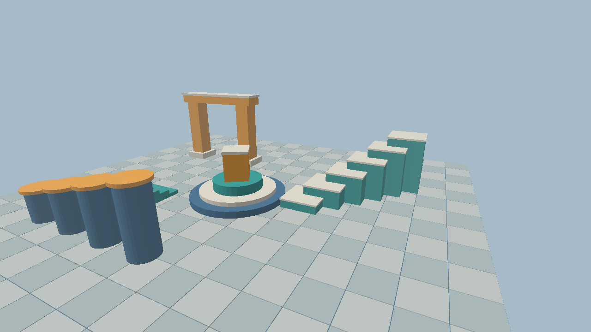

# M1 — first 3D scene, camera and GPU capture

2026-10-15, branch `codex/m1-first-scene`, based on merged M0 `b474de8` / PR #3.
The owner explicitly authorized M1, local tests, push and merge after checks pass.
Windows CI results and downloadable builds are recorded in [PR #4](https://github.com/esotericode/microjump/pull/4).
M1 stays **in progress** until the owner verifies the Windows build on their GPU.

## What works

- An original Vulkan 1.3 forward draw of code-generated boxes/cylinders: a tiled
  plaza, stepped platforms, columns, an arch and a central marker. This is a render
  fixture rather than the final playable JSON level. No external art or game code.
- Project math: column-major transforms, right-handed +Y world, infinite reverse-Z
  projection, D32 depth cleared to 0 and GREATER comparison. Linear shading and
  sRGB color attachments. Dynamic shadows and richer materials are M3.
- Fixed 120 Hz camera movement with position interpolation and immediate mouse
  look. WASD/QE flight, RMB relative mouse, Shift fast, Home reset, F1 overlay,
  focus-aware input and Escape/close exit.
- A toggleable Dear ImGui diagnostics overlay: FPS/frame time, actual pixel
  resolution, effective FIFO VSync and uncapped application state. No benchmarks.
- `--frames N`, `--capture-frame N --capture-out PATH.png`; one-based rendered
  frames, clean bounded exit, captured overlay and scene, Unicode-capable paths.
- Per-frame offscreen RGBA sRGB/D32 images, two CPU frame slots, timeline completion
  and one present semaphore per swapchain image. GPU copy/readback waits completion
  and handles noncoherent host memory before writing PNG. Resize rebuilds resources
  after device idle; minimized windows pause rendering and wait for events.
- Project GLSL is compiled by `glslc` at build time, packaged in `shaders/` and found
  relative to the executable. Runtime zips include SDL, notices, compiled shaders,
  a short player README and the MSVC redistributable DLLs on Windows.

The presentation synchronization follows the [Khronos semaphore reuse guidance](https://docs.vulkan.org/guide/latest/swapchain_semaphore_reuse.html).
Renderer, geometry, math, camera, loop and capture plumbing are project-owned;
approved Dear ImGui is used only for the overlay, and stb writes/decodes PNGs.

## Local verification

Ubuntu 26.04, GCC 15.2, Clang 21.1.8, Intel Meteor Lake GPU, Vulkan validation
1.4.341. Debug builds enable synchronization validation as well as ASan/UBSan.

For each of `linux-debug`, `linux-clang-debug`, `linux-release`:

```sh
tools/local-env.sh cmake --preset PRESET -DMJ_SMOKE_TESTS=ON
tools/local-env.sh cmake --build --preset PRESET --parallel 4
tools/local-env.sh ctest --preset PRESET -V
```

GCC Debug was exercised natively on Wayland/Intel. Clang Debug and GCC Release were
also exercised under Xvfb/software Vulkan, matching the Linux CI path:

```sh
tools/local-env.sh env SDL_VIDEO_DRIVER=x11 VK_DRIVER_FILES=/usr/share/vulkan/icd.d/lvp_icd.json xvfb-run -a ctest --preset linux-clang-debug -V
```

All **8 CTest tests passed** in each configuration. The 8 doctest cases include
2,373 assertions: projection/handedness, generated normals/winding, 120 Hz tick
and camera invariance at different render cadences, clock catch-up bounds, strict
CLI parsing and PNG error handling. GPU tests render and decode baseline, moved
camera and resized captures. The checker rejects clear-only images, verifies scene
changes outside the overlay, checks resize/aspect and opaque alpha, and round-trips
a known 2×2 RGBA pattern to catch channel/row reversal.

Native captures reported:

```text
Vulkan device: Intel(R) Graphics (MTL)
Render targets: 1600x900
GPU frame captured as PNG
Shutdown complete; Vulkan validation errors: 0
```

The resize test recreated targets at **1600×900 → 1200×800 → 1600×1000** on the
owner's 1.25× scaled display. Xvfb used logical/pixel sizes 1280×720 → 960×640 →
1280×800. These are correctness observations, not performance measurements.

Real SDL input was tested separately in an isolated Xvfb server:

```sh
tools/local-env.sh env SDL_VIDEO_DRIVER=x11 VK_DRIVER_FILES=/usr/share/vulkan/icd.d/lvp_icd.json xvfb-run -a tools/input-smoke.sh ./build/linux-debug/game/microjump captures/m1-input.png
```

The script focuses the window, holds/releases W, holds RMB and injects relative
mouse motion, toggles F1, captures and exits. The inspected capture shows a moved
and rotated view with the overlay hidden; exit reported zero validation errors.
The bootstrap script includes the optional Xvfb/xdotool test tools.

Formatting and implementation static analysis:

```sh
find engine game tests -type f \( -name '*.cpp' -o -name '*.hpp' \) -print0 | xargs -0 tools/local-env.sh clang-format --dry-run --Werror
find engine/src game -name '*.cpp' -print0 | xargs -0 -n 1 tools/local-env.sh clang-tidy -p build/linux-clang-debug
```

## Inspected captures

M0 had no rendering or GPU frame-capture path, so there is no genuine M0 GPU
screenshot to attach as a before image. These are the first rendered scene and
its camera/resize variations, captured from the GPU and visually inspected:






## Issues found and resolved

- Synchronization validation caught a swapchain acquire/layout-transition
  WRITE_AFTER_READ hazard in the first rendering attempt. The transfer-destination
  barrier's source stage now chains the acquire semaphore wait at TRANSFER; repeated
  rendering, capture and resize runs report zero validation errors. The initial
  failing capture is not used as completion evidence.
- Static analysis identified argument-order risks in projection, primitive and
  Vulkan resource/barrier helpers. Those interfaces now take explicit descriptions
  instead of several interchangeable scalar/flag parameters.
- The M0 Fontconfig-only LSan suppression remains for the external Wayland GTK
  decoration plugin (320 bytes on this machine). No engine/Vulkan/ImGui allocations
  or additional libraries are suppressed. The inherited GTK backend setting may
  still produce a decoration warning while the Vulkan window renders correctly.

## Acceptance and limitations

- Owner Windows check: extract the PR's Release zip, run `microjump.exe`, move/look,
  reset, toggle the overlay, resize/minimize/restore, then capture frame 12 and
  inspect `frame.png`. Hosted MSVC CI proves builds/unit tests/packaging; it does
  not prove rendering on the owner's GPU. Record that result before marking M1 Done.
- This is a debug flight camera; controller gameplay, gamepad controls, input
  record/replay, collision, shadows, JSON level loading and display settings are
  later milestones. Camera test input is a correctness fixture, not a replay format.
- Linux runtime zips use the platform C/C++ runtime. FIFO VSync is the M1 default;
  no application cap, VSync toggle or settings persistence is claimed.
- Human camera-feel acceptance remains open. The PR includes a concrete playtest
  request; passing numerical tests does not establish subjective feel.
