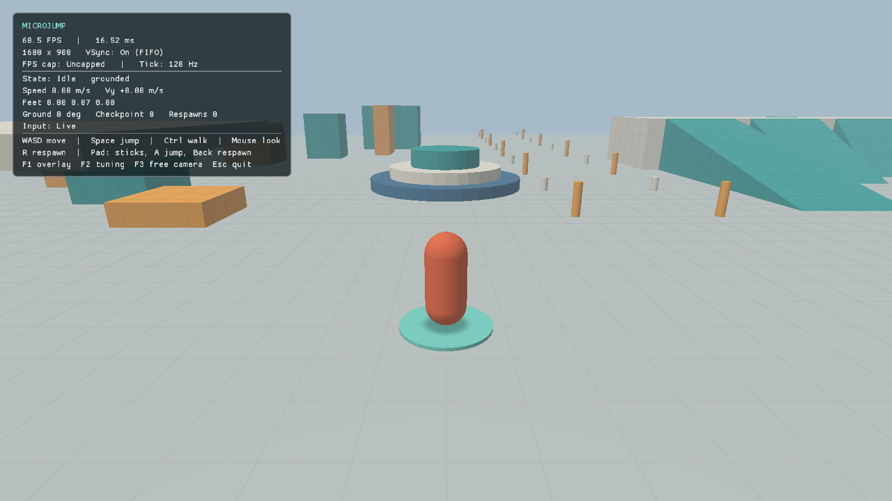
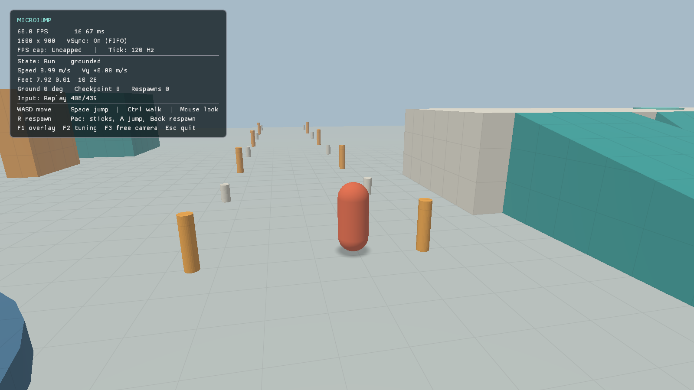
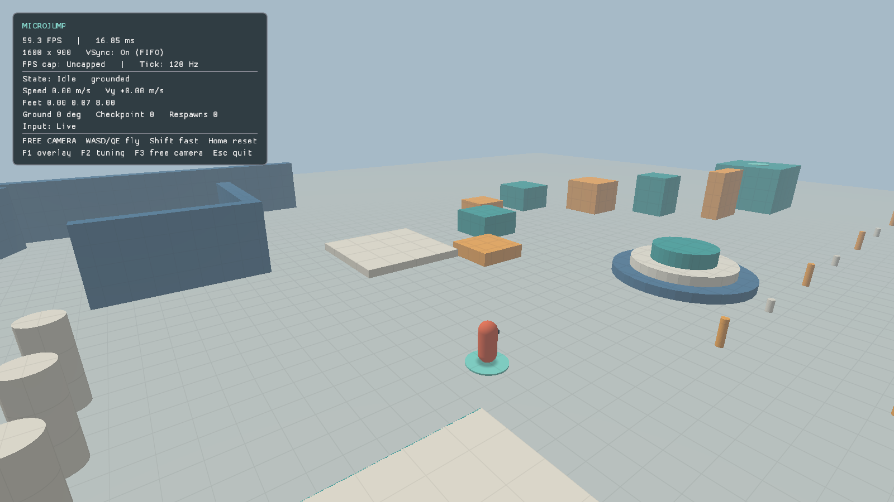

# M2 — movement slice: capsule controller, follow camera, record/replay

2026-10-15, branch `claude/m2-movement`, based on `main` after M1 (PR #4) and the
LSan fix in PR #5. The owner asked for the next steps after M1; M0/M1 Windows
hardware acceptance is still open (D-025).

M2 stays **in progress** until the owner answers the playtest request below.
Feel can't be verified from code or tests.


## What works

- **Collision world** (`engine/collision`): static triangle soup built from the same
  triangles that are rendered, with a median-split BVH. It supports raycasts,
  upright-capsule sweeps and depenetration. Sweeps use conservative advancement on the
  exact segment–triangle distance, so a step can never skip past a surface. A 1 km move
  through a 5 cm wall stops at the wall. Queries are one-sided (closed, CCW
  primitives), which removes floor-grazing false contacts.
- **Character mover** (`move_character`): kinematic collide-and-slide.
  - Walkable slopes (≤ 50° by default) keep horizontal speed and follow the surface.
  - Steeper faces act as vertical walls for horizontal motion, so running or air
    steering can't climb them. Only vertical motion slides along them.
  - Ledges up to 0.35 m are stepped by rolling over the edge across a few ticks. A
    step only lands when the face it lands on is walkable and no higher than
    `step_height`.
  - Ground snap (0.3 m) keeps the capsule on descending slopes and stairs.
  - Two-plane creases are handled and corners don't jitter.
- **Player** (`game/player.*`):
  - Ground movement: SM64-inspired facing-plus-speed model with acceleration to run
    speed, turn rate that drops with speed, a slowdown while turning, and a skid then
    turnaround on sharp reversals. Walk modifier.
  - Jumping: variable height (extra gravity after an early release), heavier fall
    gravity, a launch bonus proportional to ground speed, coyote time and jump
    buffering.
  - Air steering: limited acceleration that keeps faster momentum but never adds
    speed beyond `air_speed`.
  - Landing preserves momentum. Head bumps zero upward speed. Running into a wall
    head-on stops; a glancing hit slides along the wall.
- **Follow camera** (`game/follow_camera.*`):
  - Mouse and right-stick orbit is applied immediately every frame. Yaw/pitch limits,
    sensitivity and invert Y are tunable.
  - Focus smoothing runs on the fixed tick. It holds vertical framing steady during
    jumps until the player leaves a 1.8 m window.
  - Obstruction uses a sphere sweep. The camera pulls in instantly and eases back out.
    The obstruction is re-checked every frame for the current orientation, so fast
    turns can't show the inside of a wall.
- **Simulation** (`game/simulation.*`): player, camera and checkpoints on the fixed
  120 Hz tick.
  - Falling below `kill_height` respawns at the last checkpoint stood on. R or
    gamepad Back respawns too.
  - Given the same `TickInput` sequence, a run is bit-identical whatever the render
    rate.
- **Record/replay** (`engine/core/input_record.*`, `--record PATH`, `--replay PATH`):
  - Each tick stores the camera-relative stick, camera yaw/pitch, jump held/pressed and
    respawn press.
  - The format is versioned, run-length-encoded text with shortest round-trip floats,
    so files are exact and diffable.
  - Press edges are latched from SDL events until the next tick, so a tap shorter than
    one frame still jumps.
  - A replay ignores live input and exits when it ends, logging the final state at
    full float precision.
- **Input** (`engine/platform/window.*`):
  - Keyboard: WASD, Space jump, Ctrl walk, R respawn.
  - Mouse: captured relative-mode look. The cursor is released while the tuning window
    is open or ImGui wants the mouse.
  - First SDL gamepad: left stick moves, right stick looks, A jumps, Back respawns,
    Start opens tuning. Sticks use a radial dead zone.
- **Rendering changes:**
  - One upload holds several meshes. Each draw sends a rigid transform as 64-byte push
    constants; view-projection, sun and camera position go in a per-frame uniform
    buffer, which M3's lights will extend.
  - Back-face culling. A world-space 1 m grid on level surfaces helps read speed.
  - A **blob contact shadow** under the player shows height and landing position until
    M3's shadow maps. Haze is now measured from the camera, not the world origin.
- **Debug UI:**
  - The F1 overlay adds movement state, speed, vertical speed, feet position, ground
    angle, checkpoint, respawns and input mode.
  - **F2** opens a live tuning window with every `PlayerTuning`, `MoveSettings` and
    `FollowCameraTuning` value, plus reset buttons.
  - **F3** toggles the M1 free-flight camera.
- **M2 test yard** (`make_movement_yard`): plaza tiers (0.5/1.0/1.8 m), 15/30/45/58°
  ramps to a 3 m deck, 0.25 m stairs, 0.45 m stairs (jump), 0.15/0.30/0.40/0.60 m step
  blocks, an 8-platform rising field with a narrow beam, a sprint lane with markers
  every 5 m, long/right-angle/acute walls, pillars, a 2.0 m-clearance tunnel, a
  floating slab and four checkpoints. Teal means climbable, orange means jump, red is
  the too-steep ramp. It is a `Level` struct of primitives; M4 loads the same
  structure from JSON and builds the 200 m playground.

## Tuning reference

All values are in `PlayerTuning` (`game/player.hpp`), `MoveSettings`
(`engine/include/mj/collision/character_mover.hpp`) and `FollowCameraTuning`
(`game/follow_camera.hpp`), and all are editable live with F2. Units are meters,
seconds and radians at the 120 Hz tick. Gravity and launch speed are derived from
`jump_height` and `jump_time_to_apex`, so jump shape is tuned directly. Defaults:
run 9 m/s, full-hold apex 2.2 m in 0.38 s (30.5 m/s²), fall gravity ×1.45, early
release ×2.8, coyote 0.1 s, buffer 0.12 s.

These are first-guess values for a 1.6 m character, not SM64 values: no SM64 constant
or code was used (clean-room rule). The design reference was general, public knowledge
of how SM64 moves: commitment while turning, skids, speed-dependent jumps.

## Verification

Commands for each of `linux-debug` (GCC + ASan/UBSan + validation),
`linux-clang-debug` and `linux-release`:

```sh
tools/local-env.sh cmake --preset PRESET -DMJ_SMOKE_TESTS=ON
tools/local-env.sh cmake --build --preset PRESET --parallel 6
tools/local-env.sh ctest --preset PRESET
```

All **10 CTest tests** passed in all three configurations on native Wayland/Intel MTL.
In one Release run, `capture_pixels` failed because `--resize-test` captured frame 16
after the first resize (1200×800) instead of the second (1600×1000). It did not recur
in 23 more Release runs on this branch. `main` gave 16/16 correct. The resize fixture is
unchanged from M1, so a late Wayland resize acknowledgement is the likely cause, but
that isn't proven. Hosted CI uses Xvfb, where the resize is synchronous.
The doctest suite has 24 cases and 4,770 assertions. New coverage:

- **Collision:** closest-point regions; BVH raycasts against brute force over 600
  random triangles; sweeps stop within the skin, a 1 km move doesn't tunnel through a
  5 cm wall, and separating or tangential motion isn't blocked; depenetration.
- **Mover:** full speed on flat ground; head-on stop and diagonal slide; a stable
  corner; a 0.30 m step climbed and a 0.50 m step blocked; 15/30/45° ramps climbed and
  descended grounded on every tick; a 58° ramp blocked; walking off a ledge leaves the
  ground.
- **Movement:**
  - Held-jump apex within 4% of `jump_height`; a tap jump below 60% of it.
  - Acceleration to run speed with no overshoot in under 0.6 s; turn rate limited at
    speed; skid and turnaround.
  - Coyote jump allowed inside the window and refused after it; buffered press fires on
    landing, stale press doesn't.
  - In the yard: stairs, the 45° ramp and the 0.30 m block are climbed; the 58° ramp and
    0.60 m block block. Jumping in the tunnel bumps the roof.
  - Kill-plane respawn and respawn button.
  - Camera pulls in when a wall is behind the player; pitch/yaw clamps hold.
- **Determinism:**
  - The same held input sampled per frame at 30, 60, 144 and 240 Hz and an irregular
    4–31 ms cadence gives **bit-identical** player and camera state after 360 ticks.
  - Serializing that tick stream, parsing it back and replaying it gives the same bits.
- **Replay format:** exact float round trips including −0 and denormals, run-length
  encoding, rejection of malformed, oversized and unknown input, and CLI validation.
- **GPU/CTest:** `render_replay` replays a committed real-input session with a capture.
  `replay_completes` requires `Replay finished: tick 439 … grounded … validation
  errors: 0`. `capture_pixels` now also validates the replay capture.

**Record → replay across renderers and frame rates.** `tools/input-smoke.sh` drove the
game under Xvfb with real X11 events: hold W, turn the mouse, tap Space, hold Space,
strafe D, mouse-look up, F1. It ran with software Vulkan at ~117 FPS and recorded
`tests/replays/m2-input-smoke.mjr`. Recording logged `tick 439, feet (8.378, 0.006,
-12.560), Run, grounded`. Replaying that file natively on the Intel GPU at 60 FPS logged
the same state. Full-precision replays in GCC Debug, Clang Debug and GCC Release all
match the committed expectation:

```text
Replay finished: tick 439, feet (8.37801552, 0.00595231727, -12.5603285), state Run, grounded, checkpoint 0
```

```sh
tools/local-env.sh env SDL_VIDEO_DRIVER=x11 VK_DRIVER_FILES=/usr/share/vulkan/icd.d/lvp_icd.json \
  xvfb-run -a tools/input-smoke.sh ./build/linux-debug/game/microjump captures/input.png captures/input.mjr
tools/local-env.sh ./build/linux-debug/game/microjump --replay captures/input.mjr
```

Formatting (`clang-format --dry-run --Werror`) and `clang-tidy` (warnings as errors)
pass. Every GPU run reported `Vulkan validation errors: 0`, with synchronization
validation in Debug.

## Inspected captures

Before: [M1 scene](captures/m1-scene.png), a static render fixture with a debug camera
and no player. After (native Intel, GPU captures, inspected):

| Spawn | Running, sprint lane (replay) |
| --- | --- |
|  |  |
| **Mid-jump, 2.54 m (replay)** | **Free-camera overview** |
|  |  |

## Issues found and resolved during development

- **Step-up rejected:** the capsule first meets a step at its rounded front edge, where
  the contact normal is ~52°, so steps were judged unwalkable. Steps are now judged by
  the landed face's normal.
- **Taller blocks ratcheted:** judging steps by face normal alone let the capsule creep
  up the edge of 0.5–0.6 m blocks. Steps now also require the contact point to be no
  higher than `step_height` above the feet.
- **Stalling on convex edges:** tangential motion over a convex edge was reported as
  blocking because of rounding (dot ≈ −1e−9). The separation test now has a 1e−3
  tolerance, so stairs and ramp crests roll smoothly.
- **Air slope-climbing:** projecting air velocity onto steep faces produced upward
  motion, a slope-climbing exploit. Steep faces now act as walls horizontally, and
  only vertical motion slides along them.
- **Leak on main:** `render_capture` failed intermittently because of a system
  `libdecor-gtk` leak (PR #5, D-024).

## Limitations and open items

- **Feel is unverified.** Every value is a first guess. See the playtest request.
- **Gamepad untested:** the gamepad path is implemented but no controller was attached
  to this machine. Dead zone (0.18) and stick speeds are first guesses.
- **Determinism scope:** same build only. Different compilers or C libraries may differ
  in the last float bits (the committed-replay test allows 1e−4 relative tolerance).
  Replays assume default tuning; tuning edits are not recorded.
- **Ledge dip:** a capsule rounds off ledges. When walking off an edge, the feet dip up
  to ~12 cm before the player is airborne. That's standard capsule behavior; a ledge
  stand-off could be added if playtesting finds it noticeable.
- **Not in M2:** wall jump, long jump and the full 200 m JSON playground (M4); dynamic
  shadows and lights (M3, the blob shadow is a placeholder); the collision-shape debug
  view and display settings (M5).
- **Resize fixture:** observed once in 24 native-Wayland Release runs (see Verification).
  If it recurs, `--resize-test` should wait for the requested size before counting
  frames toward the capture.
- **Windows:** CI builds and runs unit tests with MSVC. Rendering and controls on the
  owner's Windows PC are not yet verified (also still open for M0/M1).

## Playtest request

```
PLAYTEST REQUEST
Build/branch: claude/m2-movement (Windows: Release zip from the PR's CI run)
How to run:   microjump.exe   (Linux: tools/local-env.sh ./build/linux-release/game/microjump)
Try:          Run in the sprint lane and reverse direction (skid); weave the pillars; tap vs hold
              Space; running jumps across the west platform field to the beam; walk up the stairs
              and all four ramps (58° red one should refuse); jump in the tunnel; orbit the camera
              against the walls in the corner/acute-corner area; fall off the yard edge (respawn).
              With a gamepad, repeat with sticks + A.
Look for:     Does acceleration/turning feel committed but responsive? Is the jump height
              controllable and the landing clean? Is air steering too strong/weak? Any snag,
              jitter or pop on steps, ramps, edges or walls? Does the camera lag, snap or clip?
Tunables:     F2 window -> Ground (run speed, acceleration, turn rates, skid), Jump and air (height,
              time to apex, release/fall gravity, air acceleration, coyote, buffer), Collision
              (max slope, step height, snap), Camera (distance, sensitivity, half-lives, air window).
              Defaults: game/player.hpp, game/follow_camera.hpp, mover in character_mover.hpp.
```
