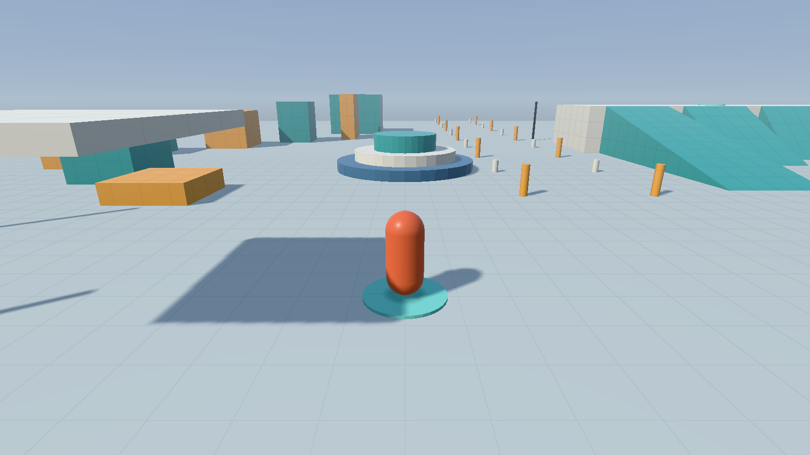
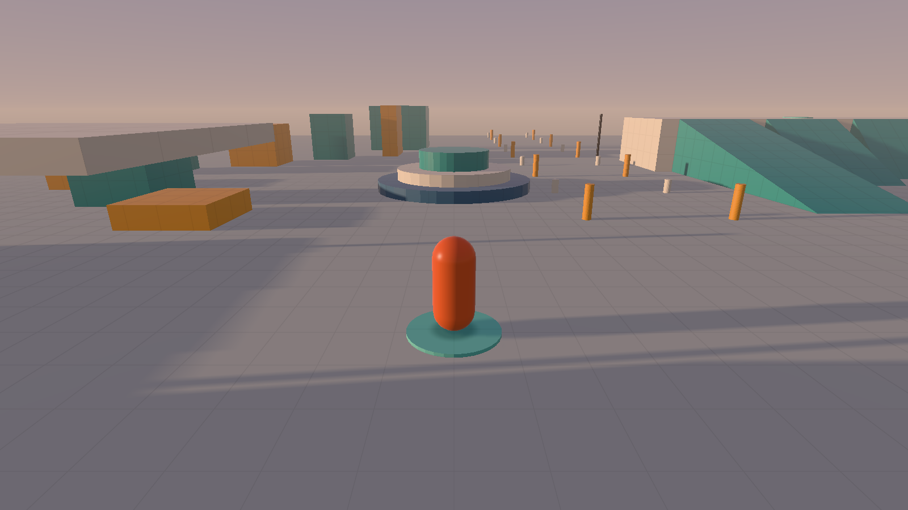
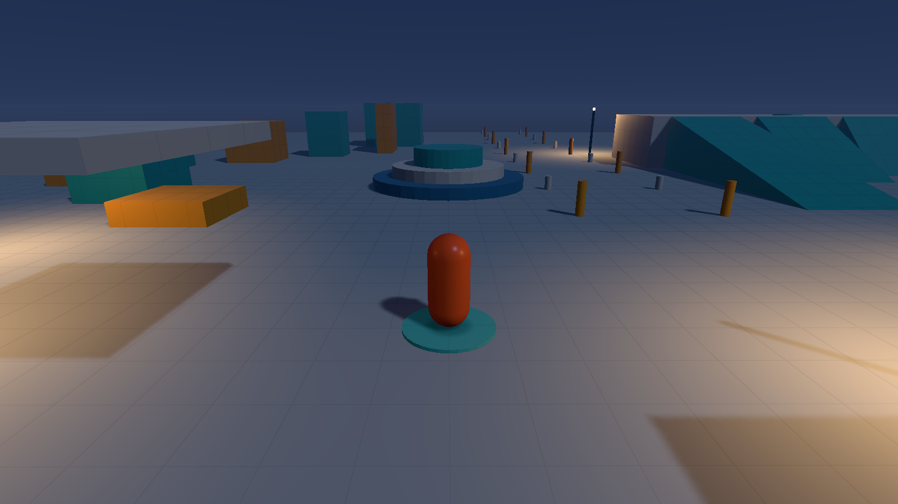
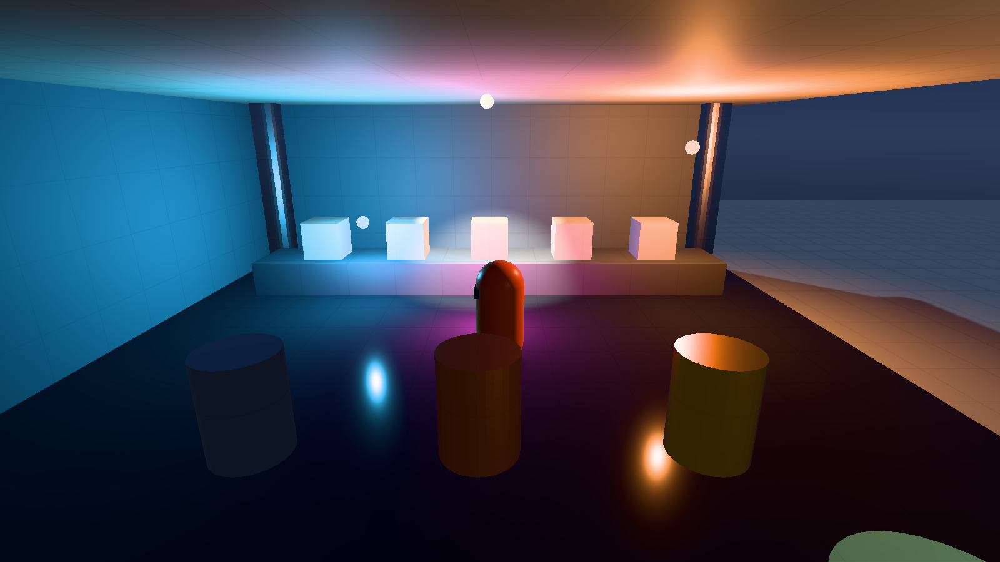
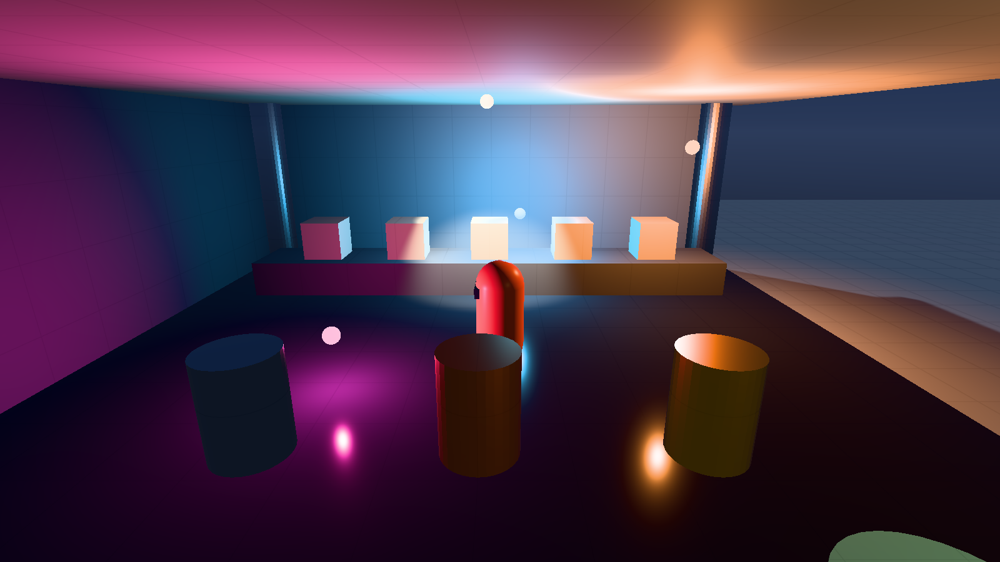
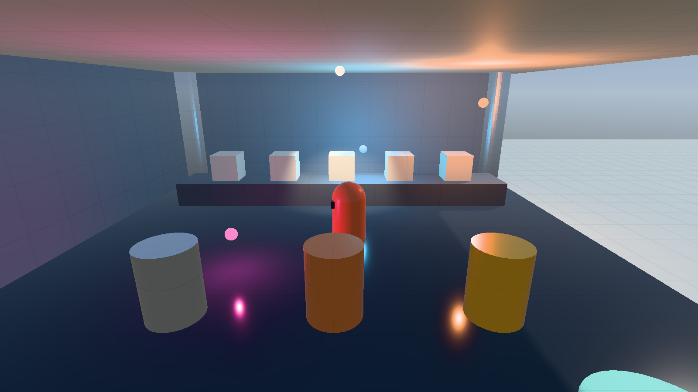
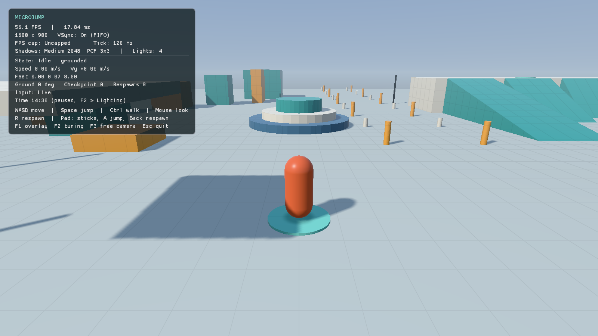
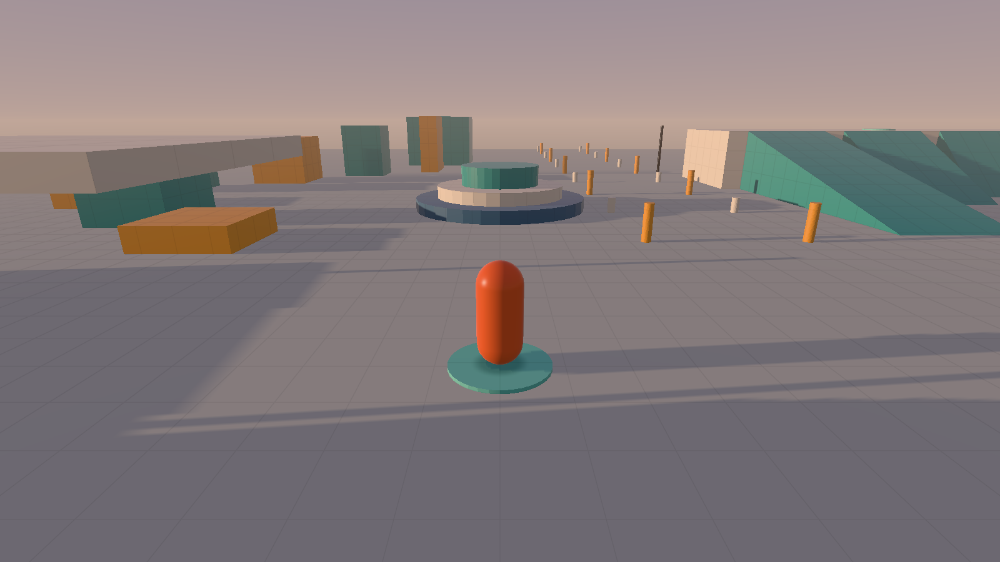
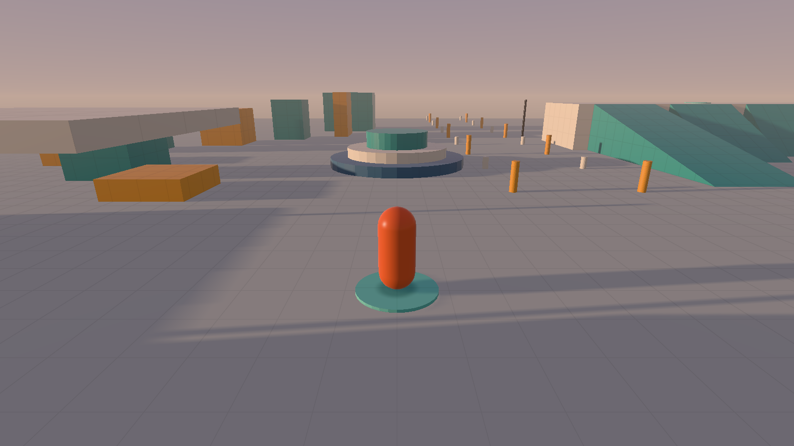

# M3 — lighting slice: sun shadows, local lights, materials, day/night

2026-10-15, branch `claude/m3-lighting`, based on `main` after M2 (PR #6, including the
review fixes). The owner asked to continue with the next part; M2's playtest and the
M0–M2 Windows GPU checks are still open (D-031).

M3 stays **in progress** until the owner has looked at it on their hardware and given an
opinion on the look. The renderer was not performance-tested; per D-004 the owner checks
performance.

| Afternoon (14:30) | Golden hour (17:18) | Night (22:00) |
| --- | --- | --- |
|  |  |  |

## What works

- **HDR forward pipeline.** Each frame runs four steps:
  1. A depth-only sun shadow pass.
  2. An HDR `RGBA16F` scene pass: sky first, then lit geometry.
  3. A tone-map pass into the sRGB target: exposure, then Khronos PBR Neutral, which
     keeps base colors and rolls highlights off to white.
  4. The ImGui overlay, then the existing blit/capture/present path.

  Lighting is computed in linear light, and the sRGB attachment encodes the output.
  Per-frame data (camera, sun, sky, fog, shadow matrix, up to 16 lights) lives in a
  uniform buffer. Per-draw transform, material flags, tint and emissive go in 80-byte
  push constants.
- **Dynamic sun shadows.**
  - A single orthographic shadow map follows the player and covers a square around them.
  - Its center snaps to whole shadow texels, so edges don't crawl as the player moves. A
    unit test checks the shift is a whole number of texels.
  - Filtering is percentage-closer with hardware bilinear compares (nearest taps if the
    GPU lacks linear depth filtering). Shadows fade out at the edge of the covered area.
  - Bias controls: D16 constant bias plus slope-scaled bias in the rasterizer, and a
    receiver normal offset measured in texels, larger at grazing light. All three are
    adjustable live.
  - Platforms, walls, posts and the player cast shadows; light bulbs don't.
- **Shadow quality setting.**

  | Preset | Map | Coverage | PCF |
  | --- | --- | --- | --- |
  | Low | 1024² | 60 m | 1 bilinear tap |
  | Medium (default) | 2048² | 80 m | 3×3 bilinear taps |
  | High | 4096² | 90 m | 5×5 bilinear taps |

  Change it live in F2 → Lighting, or with `--shadow-quality low|medium|high`. The map is
  created on first use and recreated on change. The overlay shows the active preset.
  Persisting the setting is M5.
- **Local lights.**
  - Up to 16 point or spot lights, all shaded per fragment.
  - Inverse-square falloff, windowed smoothly to zero at each light's range. Spot lights
    use a smooth inner/outer cone.
  - Placed by the level as `LightFixture` data, which M4's JSON will carry.
  - Fixtures can orbit (the moving-light demo) or be night-only street lamps that fade in
    after sunset.
  - Each light has a small emissive bulb tinted with its color. Local lights don't cast
    shadows.
- **Materials.** Every vertex carries roughness and metallic values.
  - Specular is Cook–Torrance: GGX distribution, Smith–Schlick visibility and Schlick
    Fresnel, with energy-conserving Lambert diffuse.
  - Ambient light is a sky/ground hemisphere plus a roughness-blended sky reflection, so
    glossy surfaces still read as glossy in shade.
  - Level palettes assign roughness per color. The pavilion adds a polished floor,
    brushed-steel pillars, five dielectric samples from roughness 0.05 to 0.95, and gold,
    copper and steel metal samples.
- **Day/night cycle and sky.**
  - The sun rises in +X and sets in −X, arcing toward +Z. Its color warms near the horizon.
  - Below the horizon, the moon becomes the shadow-casting light, and intensities
    cross-fade through zero so nothing pops.
  - Sky gradient, sun disk and fog all come from one function, so distant geometry blends
    into the horizon.
  - Exposure rises in the dark as a simple stand-in for eye adaptation.
  - Time of day can be set in F2, animated (default day length 180 s), or set with
    `--time-of-day H`. It advances on the fixed tick and never affects gameplay.
- **Lighting showcase.** The yard gains a roofed pavilion at (30, 30), walled on its sunny
  sides so it stays in shade against the bright exterior. Inside are the material samples,
  a warm fixed light, a spot light on the samples, and cyan and magenta lights that orbit.
  Six street lamps light the plaza, sprint lane, stairs, platform field and pavilion
  approach at night. There's a checkpoint inside.
- **Contact (blob) shadow.** It's kept under the player at 35% strength, with a toggle and
  a strength slider. It stays useful for platforming when the sun's shadow falls sideways or
  the player is in shade. D-034 records that it is no longer considered temporary; the
  playtest decides.
- **Tooling:**
  - `--hide-overlay` for clean captures.
  - `--capture-tick N` captures the first frame after simulation tick N, so replay captures
    show the same moment at any frame rate.
  - The "Tuning" window (F2) gains a Lighting section: time, animation, day length,
    exposure, shadow quality and biases, local-light, bulb and contact-shadow toggles.

## Bugs found and fixed while building M3

- **Camera nudge at startup and on focus.** With M2's always-captured mouse, engaging the
  Wayland pointer lock delivered a one-off relative jump of 1–3 counts about ten frames
  later. Its size depended on where the cursor happened to be. Two identical idle runs
  differed in 8–50% of pixels.
  - Motion is now ignored for 150 ms after capture engages.
  - `--replay` never captures the mouse, because it ignores live look input. This also
    stops automated test runs from grabbing the owner's cursor.
  - Three identical runs now give pixel-identical captures.
- **Frame-based replay capture failed on software Vulkan.** The heavier M3 frame dropped
  lavapipe's frame rate, so M2's 439-tick `render_replay` ended at frame 119, before its
  `--capture-frame 160`. CI would have failed the same way. The test now uses
  `--capture-tick 320`.
- **Startup shadow map built twice.** The renderer always created a Medium map, then
  recreated it at the requested quality. It is now created once, lazily.
- **Validation warnings on the shadow pipeline.** It declared vertex attributes its shader
  never reads. It now uses a position-only input layout.

## Verification

```sh
tools/local-env.sh cmake --preset PRESET -DMJ_SMOKE_TESTS=ON
tools/local-env.sh cmake --build --preset PRESET --parallel 6
tools/local-env.sh ctest --preset PRESET
# CI-like software Vulkan:
tools/local-env.sh env SDL_VIDEO_DRIVER=x11 VK_DRIVER_FILES=/usr/share/vulkan/icd.d/lvp_icd.json \
  xvfb-run -a ctest --preset linux-clang-debug
```

All **16 CTests** pass in GCC Debug and GCC Release on native Wayland/Intel MTL, and in
Clang Debug under Xvfb/lavapipe. The doctest suite has 32 cases and 49,822 assertions.
Debug builds run ASan, UBSan and synchronization validation, and every GPU run reported
`Vulkan validation errors: 0`. Formatting and clang-tidy pass.

New automated coverage:

- **Math:** general 4×4 inverse (M·M⁻¹ = I), right-handed look-at including a straight-down
  view, and the orthographic depth/extent mapping.
- **Shadow fit:** the focus, casters 30 m above it and off-center points all project
  inside the map with valid depth for every preset. Points nearer the light have smaller
  depth. Moving the focus by 0.013, 0.37 or 1.9 m shifts the projection by whole texels.
- **Day/night:**
  - Noon is full daylight and midnight is full night.
  - The moon takes over below the horizon. Dusk light is warm. Night exposure is higher
    than day.
  - Stepping through all 1,440 minutes of a day, the light never drops below ~7°
    elevation, and sun color, horizon color and exposure never jump.
  - The time of day wraps correctly past midnight.
- **Fixtures:** the yard has at most 16 lights. Street lamps are off at noon and on at
  midnight. An orbiting light moves and keeps its radius.
- **Materials:** the rendered vertices include glossy (roughness < 0.1) and metallic
  surfaces.
- **CLI validation:** `--time-of-day`, `--shadow-quality` and `--hide-overlay`.
- **GPU tests:**
  - `render_day` (14:30), `render_night` (22:00, Low shadows) and `render_pavilion` (night,
    High shadows, scripted tour replay at tick 1380).
  - `lighting_pixels` decodes those captures and requires:
    - day mean luminance more than 40 above night (measured 182 vs 84)
    - warm lamp-pool pixels above 3% at night and more than twice the day share
      (measured 10.7% vs 2.2%)
    - over 4% strongly colored pixels in the pavilion (measured 10.5%)
  - The software-Vulkan pavilion capture matches the Intel one.

The pavilion tour (`tests/replays/m3-pavilion-tour.mjr`) is **scripted**, not live input. A
small waypoint helper steered the real headless simulation from spawn into the pavilion and
saved its tick inputs. The file's header says so.

## Inspected captures

These are GPU captures from native Intel, each visually inspected. Before: [M2 spawn](captures/m2-spawn.png),
with a single fixed light, no shadows, no HDR and no local lights. After:

**Moving lights (pavilion at night, tick 1200 vs 1380).** The cyan and magenta orbiting
lights move: the cyan one sweeps from beside the player to the left wall, and their floor
reflections follow.

| Tick 1200 | Tick 1380 |
| --- | --- |
|  |  |

**Pavilion by day.** The interior is in shade against the sunlit yard; colored light shows
on the roof, samples and polished floor. **Overlay.** Shows the shadow preset, PCF size,
light count and time.

| Pavilion, day | Overlay |
| --- | --- |
|  |  |

**Shadow quality at golden hour (sun ~10° up, the hardest case for acne).** There is no
acne on the ground, and the long post shadows stay attached to their bases. Low is softer
and blockier on the thin posts; High is crisp.

| Low (1024²) | High (4096²) |
| --- | --- |
|  |  |

## Limitations and open items

- **Look and feel are unverified by the owner.** Sky colors, sun and moon intensities,
  exposure curve, fog, material values and bias defaults are first choices tuned on the
  captures above. Everything is adjustable in F2 → Lighting.
- **No ambient occlusion and no local-light shadows.** Inside the pavilion, ambient light
  is as strong as outdoors in shade; only the sun is blocked. Ambient occlusion and
  cascaded shadows are charter stretch goals.
- **Shadow coverage is limited.** Shadows cover 60–90 m around the player and fade out at
  the edge, so distant objects are unshadowed. Cascades would fix this and are a stretch
  goal.
- **Camera note for the M2 playtest.** A waist-high obstacle right behind the player
  correctly blocks the camera boom, which pulls the camera into the player's head. This was
  seen beside the pavilion's metal samples. Platformer cameras usually lift over such
  obstacles or ignore them, but changing that needs feel testing.
- **Not performance-tested.** Per D-004. High shadows use a 4096² map and 25 taps per lit
  pixel, and the pavilion runs 4–10 lights per pixel. The owner should check frame rates,
  especially on Low vs High.
- **Windows:** CI builds and unit-tests with MSVC. Rendering on the owner's GPU is
  unverified.
- **Resize fixture:** the intermittent native-Wayland resize-capture observation from M2
  still stands.

## Owner check request

```
VISUAL / PLAYTEST REQUEST
Build/branch: claude/m3-lighting (Windows: Release zip from the PR's CI run)
How to run:   microjump   (or --time-of-day 21 to start at night)
Try:          F2 > Lighting: drag Time of day through dawn/noon/dusk/night, tick "Animate
              day/night"; walk to the pavilion (behind-right of the start) and watch the
              orbiting lights on the floor and metal samples; switch Shadow quality
              Low/Medium/High while watching post and player shadows; run around the plaza
              at golden hour (17:15) looking for acne, flicker or detached shadows.
Look for:     Is it readable and attractive? Night too bright/dark? Shadows crisp enough
              and stable while moving? Is the contact (blob) shadow still wanted?
              Frame rate on Low vs High (owner-only performance check).
Tunables:     F2 > Lighting: exposure scale, shadow biases, normal offset, blob strength.
              Code defaults: game/lighting.cpp (sky/sun/moon colors), shadow presets in
              engine/src/render/lighting.cpp, materials in game/level.cpp.
```
