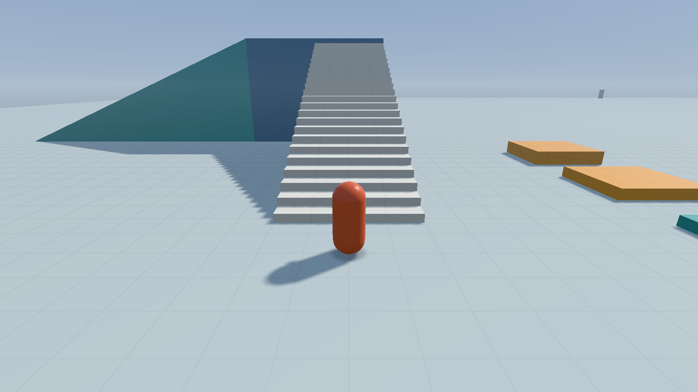

# M4, first increment: JSON levels and the connected playground

2026-10-15. Builds on the reviewed M3 lighting. This increment moves runtime
placement data into versioned JSON and expands the default yard to 230 × 230 m.
M4 remains **in progress**: wall jumps, the momentum move, and a complete human
traversal/playtest are still required. Existing M2/M3 and Windows owner gates
remain open.

Run normally for the new playground, or select a level with `--level PATH`.
The packaged default is resolved beside the executable, so launching from another
working directory works. `assets/levels/movement-yard.json` preserves the original
100-primitive lighting yard and its recordings. `make_movement_yard` remains a
headless regression fixture; runtime level loading uses JSON.

The [format guide](level-format.md) describes units, materials, lights, checkpoints,
validation and editing. The approved nlohmann/json 3.12.0 is pinned by commit and
archive hash; its MIT notice is included in runtime packages. No other dependency
or architecture choice changes.

## Playground contents and routes

225 authored primitive placements share one contiguous ground surface. There
are 10 checkpoint pads, seven named diagnostic regions, and 16 point/spot light
fixtures. The retained pavilion has orbiting colored lights and material samples.
Colored paired posts identify the entrances to the new courses.

| Region | Approximate center (X, Z), meters | Route / purpose |
| --- | --- | --- |
| Central plaza | 0, 0 | Original run/turn/jump yard and tiered centerpiece. Spawn is at (0, 8). |
| Sprint lane | 7, −66 | Extended markers every 5 m toward Z = −110; checkpoint near the north end. |
| Platform field | −69, −33 | Four eight-platform routes of decreasing width, 0.6 m rises and 2 m gaps. Together with the original eight platforms, there are 40 route platforms. A shared 4.8 m finish deck has a ramp return to the ground. |
| Wall course | 70, −46 | Paired walls, a ground approach and jump platforms. Geometry is prepared for the next wall-jump slice; this increment does not implement that verb. |
| Slope and step course | 60, 31 | 24 walkable 0.25 m stairs lead to a 6 m summit. A ramp returns to the floor; separate blocks distinguish walkable steps from jump-height obstacles. |
| Lighting pavilion | 30, 30 | Existing shaded material/lighting showcase and checkpoint. |
| Yard slopes | 23, −10 | Existing 15/30/45/58° ramps; red remains too steep. |

Every optional platform route has a ground bypass. The outer edge is open;
falling below the kill plane returns to the last pad stood on. R respawns too.
The overlay identifies the loaded level and current region.

## Inspected GPU captures

Before: [M3 yard](captures/m3-day.png). After, native Intel GPU captures:

| Platform field from its finish checkpoint | Summit stairs from the approach |
| --- | --- |
|  |  |

[Spawn and region overlay](captures/m4-spawn.png) ·
[Prepared wall-course geometry](captures/m4-walls.png).
The field/wall views select an existing checkpoint as the first JSON checkpoint;
the stair approach uses a temporary checkpoint at (63, 0.01, 28). Geometry and
lighting are unchanged. These are view fixtures, not recordings of full traversal.

## Verification and remaining work

The review PR records exact build/test results, inspected GPU captures and Linux /
Windows runtime downloads. Automated checks cover schema rejection, UTF-8 paths,
the original yard's placement/material parity and recorded movement outcome,
safe settling/activation of all 10 checkpoints, the extended sprint lane, and
walking the summit stairs. Existing collision, replay and lighting checks remain.

Local verification: all **20 CTests** pass on GCC Debug and GCC Release with
native Intel Vulkan, and Clang Debug with Xvfb / software Vulkan. All 37 doctest
cases / 50,645 assertions pass. Debug runs enable ASan/UBSan and Vulkan
synchronization validation; every GPU test reported zero validation errors.
Formatting, diff checks and clang-tidy pass. The new default capture is also
decoded and checked for nonempty scene pixels. Build/test commands:

```sh
tools/local-env.sh cmake --preset PRESET -DMJ_SMOKE_TESTS=ON
tools/local-env.sh cmake --build --preset PRESET --parallel 4
tools/local-env.sh ctest --preset PRESET -V
```

The Release zip was extracted and run from `/tmp` with the development library
path removed. It loaded the packaged default JSON, found its shaders, rendered
and captured tick 60, then exited successfully.

`tools/input-smoke.sh` drove real SDL keyboard/mouse events under Xvfb and recorded
a 1,419-tick session on the new default playground. Replaying it on native Intel
Vulkan reached the identical full-precision final state:

```text
tick 1419, feet (8.68328094, 0.0294266492, -14.1695566), state Idle, grounded, checkpoint 0
```

This is a functional input/replay check; no frame-rate measurements were used.

These tests establish particular routes and fixtures, not approval of movement
feel or proof that every jump is well tuned. The next M4 increment adds designated
wall-jump surfaces and a momentum move, then exercises full routes with replays.
The historical Wayland resize fixture and near-obstacle camera feel remain known
items; this change does not claim to resolve them.

```text
PLAYTEST REQUEST
Build/branch: codex/m4-json-playground (Windows Release zip in the PR)
How to run:   microjump.exe
              Linux: tools/local-env.sh ./build/linux-release/game/microjump
Try:          From spawn, head west to the four new platform lanes; follow a lane
              north to the blue finish deck and take its east ramp back down.
              Run the extended sprint lane north; head east to the wall course;
              climb the new southeast stairs to the summit and descend the ramp.
              Stand on checkpoint pads, fall off the outer edge, and use R.
Look for:     Readable connections, platform gaps, safe checkpoint landings,
              step/ramp snagging and camera clipping. Wall jumping comes next.
Tunables:     F2 for movement/camera/lighting; placements in playground.json.
```
