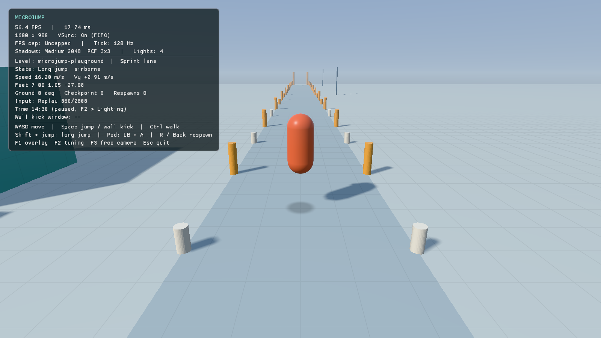
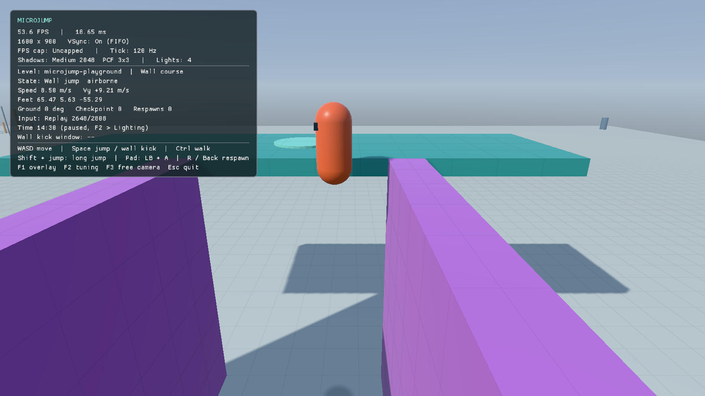
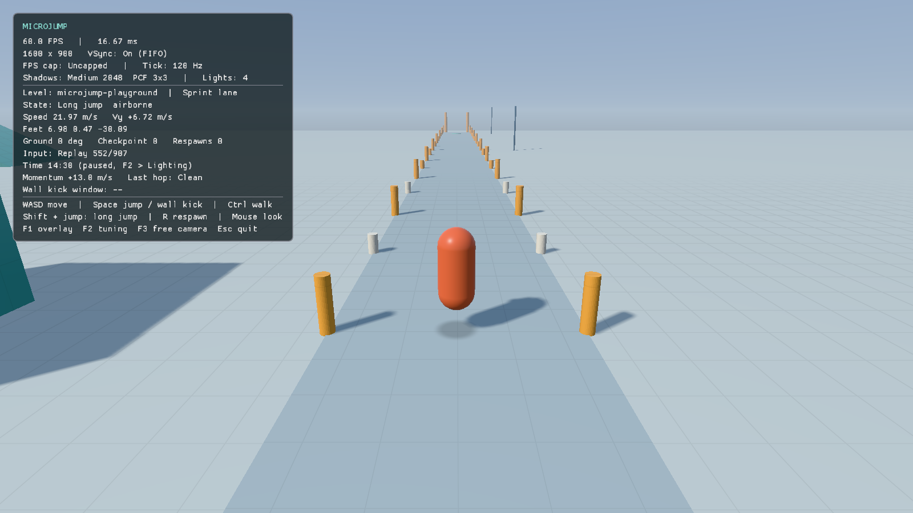
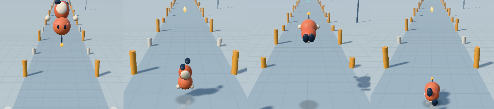

# Movement and camera

The player is a kinematic capsule, 0.35 m in radius and 1.6 m tall, simulated on the
fixed 120 Hz tick. Every value below lives in `PlayerTuning` (`game/player.hpp`),
`FollowCameraTuning` (`game/follow_camera.hpp`) or `MoveSettings`
(`engine/include/mj/collision/character_mover.hpp`), and every value has an F2
slider. Units are meters, seconds and radians. What the player sees is an animated
character drawn over the capsule; see [character](character.md).

| Long jump | Wall kick | Chained long jumps at 22 m/s |
| --- | --- | --- |
|  |  |  |

## The verbs

**Running.** The player has a facing and a speed rather than free velocity. It
accelerates to `run_speed` (9 m/s), turns more slowly the faster it goes, loses some
speed while turning, and skids before turning round when the stick reverses sharply at
speed. Ctrl, the right shoulder or a partial stick tilt walks.

**Jumping.** Gravity and launch speed are derived from `jump_height` (2.2 m, holding the
button) and `jump_time_to_apex` (0.38 s), so the jump shape is tuned directly.

- Releasing early cuts the jump (×2.8 gravity while rising), and falling uses ×1.45.
- Ground speed adds a small launch bonus, but only up to run speed.
- The forgiveness rules: coyote time (0.1 s) and a jump buffer (0.12 s).
- Air steering can always reach `air_speed` (7 m/s), and anything faster is kept.

**Wall kicks.** Only shapes marked `wall_jump` in the level qualify, and the playground
paints them purple. While airborne at one, press jump to kick outward and up
(8.5 m/s out, 12 m/s up). The kick has a fixed arc that releasing the button doesn't cut,
and a 0.14 s steering lock to separate from the wall.

- There is a 0.1 s grace period after touching the wall.
- Before landing again, the next kick must be off a face at least 60° different from
  the last, so alternating walls climbs but one wall can't be farmed.

**Long jump.** Running at 6 m/s or more, hold Shift or the left shoulder and press jump.
The jump is fast and low on a fixed arc: `run_speed × 1.8` forward and 8.5 m/s up.

**Double and triple jumps.** These follow Super Mario 64 (`act_double_jump` and
`act_triple_jump` in the decompilation).
- Jump again within `jump_chain_window` (0.15 s, SM64's five frames) of landing a jump
  for a double jump. It launches 1.2× as fast and goes about 1.44× as high, 3.8 m from a
  run. Like a jump, releasing early cuts it short.
- Land that and jump again while moving at 5.6 m/s or more for a triple jump: 1.38× the
  launch speed and about 1.9× the height, 5 m. It's a fixed arc with a somersault.
- Waiting longer, a long jump, a wall kick, a dive or walking off a ledge starts the chain
  over.
- Standing still, the third jump starts a new ordinary jump.

**Dive.** Press E, the left mouse button or the West face button.
- **Where from.** A dive comes from a run of at least 6 m/s, or out of a jump, double,
  triple, fall or wall kick. Long jumps are committed and can't dive during their whole
  airtime, including descent or a ceiling hit, and there is one dive per airtime.
- **Speed.** It lunges along your facing, adding `dive_boost` (4.2 m/s, SM64's 15 of 32)
  up to `dive_max_speed` (13.5 m/s). Faster momentum is never lost.
- **Arc.** From the ground it lifts 3 m/s. In the air it keeps your vertical speed, so
  it stretches a jump rather than lifting it. Steering drops to 30%.
- **Belly slide.** A dive lands on its belly and slides, slowing at 9 m/s² and steering
  only gently. It stands up once slow.
- **Rollout.** Jump or dive during the slide to roll out: a small fixed hop (7.5 m/s up,
  about 0.9 m) at the slide's speed. A jump pressed while still diving rolls out the
  instant you land.
- **Speed tech.** Dive, roll out and hop cleanly to carry about 13 m/s, much like
  SM64's dive-rollouts.



## Moving platforms

The simulation steps every mover before the player each tick. Then:

- **Riding.** Standing on a mover carries you through its step, sweeping so a wall can
  scrape you off, and a turning mover turns your facing with it.
- **Leaving.** Jumping, walking or bouncing off adds the platform's velocity at your
  feet, so you keep moving with it.
- **Landing.** Landing on a mover counts only your velocity relative to it, so a hop in
  place on a moving platform lands in place. On a mover you keep only your forward
  speed and never turn round: dropping onto a turntable lands you standing on it.
- **Pushing.** A mover that runs into you pushes you out, through the mover's usual
  depenetration. Nothing crushes: lay movers out so they can't pin you.

None of this touches a level without movers, so every recording keeps its bits.

## Momentum

Speed above `run_speed` is **momentum**. You build it on purpose, and it isn't free.

| Source or drain | Rule |
| --- | --- |
| Long jump | Launches at `run_speed × 1.8`, or current speed + `long_jump_chain_boost` (2.5 m/s) when chained, capped at `max_speed` (22 m/s). |
| Downhill | Holding forward down a walkable slope adds `slope_momentum` (0.4) × the slope's gravity. Standing still never slides. |
| Clean hop | A takeoff within `hop_window` (75 ms) of touchdown, either side, keeps all momentum. |
| Early hop or mashing | A buffered press from before the window still jumps, but keeps only `early_hop_retention` (40%). Mashed presses count from the first press. |
| Late | Flat ground drains `overspeed_friction` (14 m/s²); uphill drains more. |
| Turning or easing off | Momentum is kept only with the stick near full and within about 25° of facing. |
| Air | `air_drag` (0.6 m/s²) back down toward run speed. |
| Height | Momentum buys distance, never extra jump height. Wall kicks reset to their fixed launch. |

Slopes are judged by the triangle's face normal, not the rounded capsule contact, which
tilts up to 30° at ledges. The F1 overlay shows `Momentum +x.x m/s` and the timing of
the last takeoff (Clean, Early or Late), so the rule can be learned rather than guessed.

Measured takeoff speeds after one long jump from full run, in m/s:

| Timing | Long jump | Hop 1 | Hop 2 | Hop 3 | Hop 4 |
| --- | --- | --- | --- | --- | --- |
| Clean hops | 16.19 | 15.89 | 15.43 | 14.98 | 14.52 |
| Early or mashed | 16.19 | 11.75 | 9.92 | 9.18 | 9.00 |
| Clean long-jump chain | 16.19 | 18.39 | 20.59 | 22.00 | 22.00 |

### What other games taught us

- **Super Mario 64:** the long jump is fast, low and committed. Its backwards-long-jump
  exploit stacks speed without a limit. So: give momentum a hard ceiling and the
  special moves fixed, readable arcs.
- **Titanfall 2 slide hopping, Quake/Source bunny hopping:** speed is kept by jumping
  as you land, and friction takes it when you miss. A buffered jump never misses, so
  the buffer must not grant the reward by itself.
- **Celeste:** coyote time and buffering make the controls forgiving without lowering
  the skill ceiling. Keep the forgiveness; only the reward depends on timing.
- **Sonic, Tribes, A Hat in Time:** slopes are a speed source. Downhill builds, uphill
  costs, and the level becomes a tool.
- **Swink's *Game Feel*, and Pittman's GDC 2016 talk "Building a Better Jump":** tune the
  jump by height and time to apex, and keep the moves predictable.

## Camera

A third-person orbit around a focus 1.3 m above the feet, 7 m away by default.

- **Orbit input:** mouse and right-stick orbit is applied every frame, with no smoothing.
  Pitch is limited to −72° to +32°, and Y can be inverted.
- **Following:** the focus follows on the fixed tick. Horizontal lag is 0.04 s. While
  airborne, vertical framing holds steady until the player drifts 1.8 m from the focus.
- **Obstruction:** a sphere sweep from the focus pulls the camera in instantly, and it
  eases back out over 0.3 s. Obstruction is rechecked every frame for the current
  orientation, so fast turns never show the inside of a wall.

## Record and replay

`--record PATH` saves every tick's input when the game exits: the camera-relative stick,
camera yaw/pitch and the button bits. `--replay PATH` plays it back instead of live
input, then exits and logs the final state at full precision. Press edges are latched
from events until the next tick, so a tap shorter than a frame still counts.

The format is text, run-length encoded, with shortest round-trip floats:

```text
microjump-replay 4
tick-rate 120
level microjump-playground
# count move_x move_y camera_yaw camera_pitch buttons
30 0 0 0 -0.32 0
```

- **Format versions:** version 2 added the long-jump modifier bit, version 3 added the
  `level` line, and version 4 added the dive bit (16). A named recording is refused on a different level. Older files still
  load, with a note.
- **Tuning:** tuning isn't recorded, so recordings assume default tuning.
- **Exactness:** results are bit-identical within one build. Across compilers the last
  float bits can differ.

## Known rough edges and ideas

- **Unplaytested:** the owner hasn't playtested movement feel. Every value is a
  considered first guess.
- **Ledge dip:** walking off a ledge, the capsule's rounded base dips about 12 cm before
  it leaves the ground.
- **Low obstacles behind the player:** a waist-high obstacle right behind the player
  pulls the camera into the player's head. Platformer cameras usually lift over such
  obstacles.
- **Ideas not yet tried:**
  - apex hang while jump is held (Celeste);
  - visible or audible feedback on a clean hop;
  - a downhill run into a gap that needs carried speed;
  - a slide or roll that turns slopes into speed;
  - a character with squash and stretch instead of a capsule.
