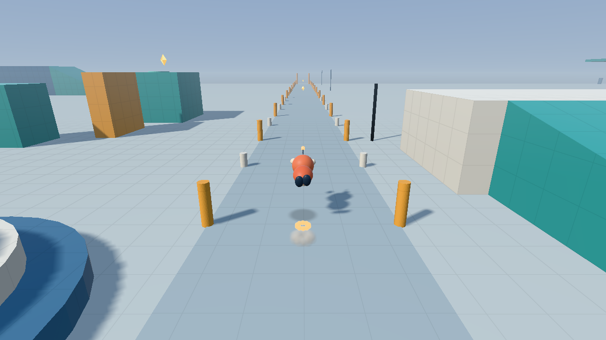
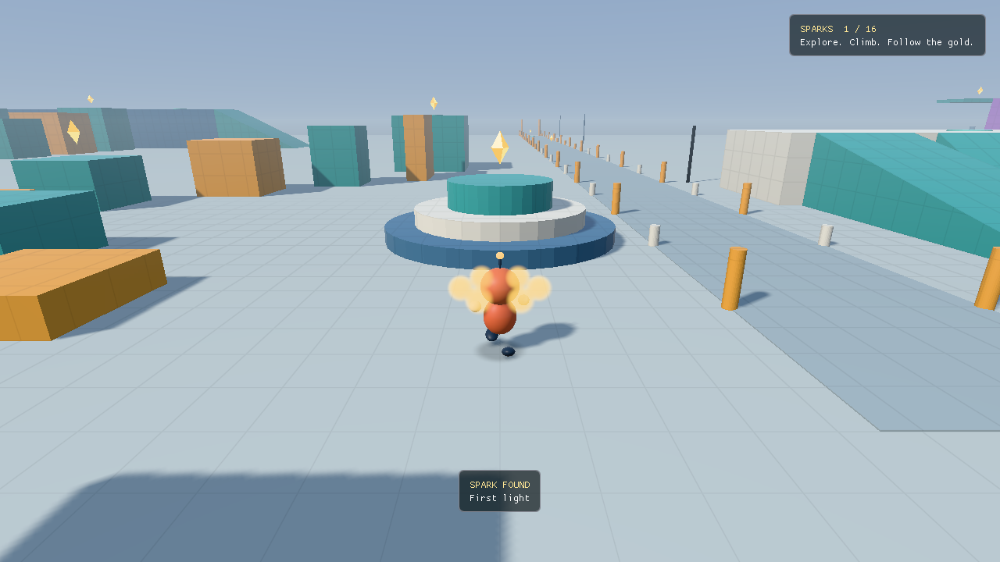

# Dust and spark particles

Skids and hard landings leave small clouds of dust. Clean momentum hops shed golden
motes, and finding a spark sends a ring of gold upward. These are transparent,
camera-facing discs with a smooth radial falloff, so they fade through the scene
instead of shrinking as solid beads.

The same recorded clean hop at tick 432, before and after the particle pass:

| Opaque spheres | Transparent particles |
| --- | --- |
|  |  |

## Rendering

`FrameView::particles` accepts `ParticleInstance` values: world position, radius in
metres, linear colour, opacity and emission. The renderer considers at most 256 entries,
drops invalid or invisible values and stably sorts them from far to near using camera
depth. Equal-depth particles retain their submission order.

The particle pipeline draws six procedural vertices per disc after the solid world and
character, into the same HDR target before tone mapping. Straight-alpha blending mixes
the particles with the scene in linear light. Dust receives hemisphere ambient light
and modest wrapped sun or moon lighting; emissive gold stays visible at night, and
distance fog matches the world. Ordinary
reverse-Z depth tests keep particles behind solid surfaces from showing through them.
Particles never write depth or cast shadows.

The fragment shader creates the radial falloff without a texture. No extra vertex
uploads, buffers or per-frame GPU allocations are needed. The HDR target must support
colour-attachment blending. Particle/world intersections use ordinary depth clipping;
there is no sampled-depth intersection fade yet.

## Timing

The character's bounded puff pool advances on the fixed simulation tick. Rendering
interpolates age and the analytic motion path; newborns do not appear before their
birth tick, and a dying puff remains available through its last interpolation interval.
Dust grows while its opacity fades; gold fades with its emission. Teleport snaps clear
the pool. The collectible burst likewise derives its age from the recorded pickup tick.
None of these visuals feed back into movement or collection.

## Verification

Headless tests cover invalid inputs, the particle budget, stable camera-depth sorting,
emitter timing and reproducibility. The `particle_render` Vulkan fixture captures a
controlled scene to test radial edges, partial opacity, solid occlusion, sorted overlap,
coincident layers without depth writes, and opaque output alpha. Existing movement,
lighting and replay checks still exercise the full game.
